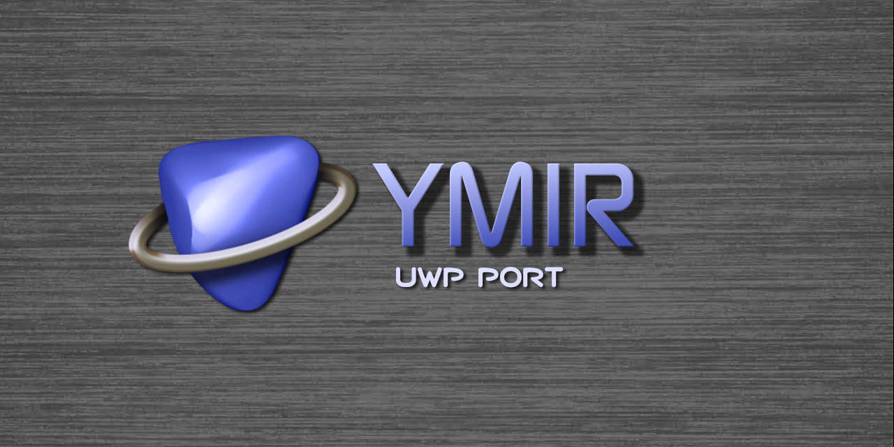

<p align="center">
  
</p>

<p align="center">
  <strong>A Sega Saturn emulator fork focused on Xbox Series X|S Dev Mode.</strong>
</p>

<p align="center">
  <a href="https://github.com/marcelofrau/Ymir/actions/workflows/uwp.yml"></a>
  
  
  
</p>

---

## About this fork

**Ymir UWP** is the Xbox / UWP port of [Ymir](https://github.com/ymir-emu/Ymir), the Sega Saturn emulator by
StrikerX3 and contributors. This fork tracks upstream Ymir while adding the platform integration and controller-first
interface needed to run it as a native UWP app.

The primary target is **Xbox Series X|S in Developer Mode**. The UWP package also runs on Windows 10/11. It is not an
Xbox Retail app, and Xbox One is not supported.

## Highlights

- Saturn BIOS-inspired, gamepad-first interface; no mouse or keyboard required for the main flow
- Game library, recent games, settings, pause menu, and file browser navigable with an Xbox controller
- Direct3D 12 hardware VDP renderer as an optional setting, with software rendering fallback
- XAudio2 backend for Xbox audio
- Saturn media support inherited from Ymir: CHD, BIN+CUE, IMG+CCD, MDF+MDS, and ISO
- Automatic IPL ROM detection and support for Saturn backup memory and save states

See the [upstream Ymir README](https://github.com/ymir-emu/Ymir) for emulator features and compatibility details.

## Download and install

Download the latest **Ymir UWP** package from [this fork's Releases](https://github.com/marcelofrau/Ymir/releases).
The ZIP includes the signed app package, certificate, Visual C++ framework dependency, and `INSTALL.md` with setup
steps for Xbox and Windows.

On Xbox, enable Developer Mode, install the `.msix` and its `Microsoft.VCLibs` dependency through Device Portal, then
set the app's **App type** to **Game** in Dev Home. BIOS ROMs and game images are not included; provide your own files.

## Build from source

Requirements and port architecture are documented in [docs/uwp/README.md](docs/uwp/README.md). Build the app and create
the distributable ZIP from PowerShell:

```powershell
pwsh scripts/uwp/build.ps1 -Configuration Release
pwsh scripts/uwp/package.ps1 -Configuration Release
```

For the Xbox controls and manual validation checklist, see [docs/uwp/TESTING.md](docs/uwp/TESTING.md). Release tags use
`uwp-v<Ymir-version>.<port-revision>`; the release workflow creates a draft so the exact package can be tested on Xbox
before publication. See [docs/uwp/RELEASE.md](docs/uwp/RELEASE.md).

## Credits

- **Xbox / UWP port:** Marcelo ([marcelofrau](https://github.com/marcelofrau))
- **Ymir emulator and Saturn emulation core:** StrikerX3 and contributors
- **Special thanks:** MewLew, alouisious, and DanP142
- **Community:** [Emulation Revival](https://emulationrevival.github.io/xbox-dev-mode/emulators.html) and the wider Sega Saturn and Xbox emulation communities for their support, ideas,
  testing feedback, and inspiration

## License

Ymir is distributed under the GNU General Public License v3.0. See [LICENSE](LICENSE). This fork retains Ymir's license.
