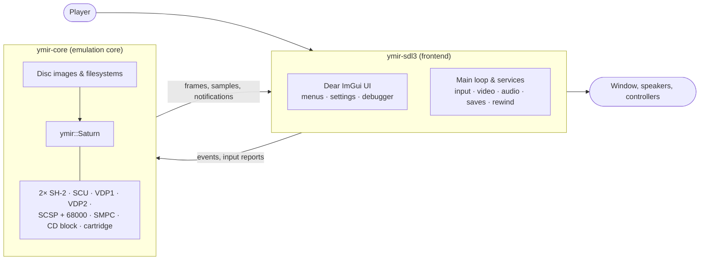

# Ymir — developer documentation

**Ymir** is a Sega Saturn emulator written in C++20 by StrikerX3 and contributors
([upstream](https://github.com/ymir-emu/Ymir)). This folder explains how it works: what the Saturn is, how the
emulation core models it, and how the SDL3 frontend turns that into a usable program.

> These pages were written for the `uwp/main` fork (`marcelofrau/Ymir`), whose purpose is the UWP / Xbox port. Apart
> from the notes that mention the port, they describe upstream Ymir 0.4.2 as found in this tree. The port itself is
> documented in [docs/uwp](../uwp/README.md). The API reference can be generated from the public headers with
> Doxygen (`doxygen Doxyfile`, output in `out/docs`).

## At a glance

- **`libs/ymir-core`** is a self-contained, platform-agnostic static library that emulates the console. It has no UI
  dependencies and no global state, and several instances can run side by side.
- **`apps/ymir-sdl3`** is the program people run. It is built on SDL3 and Dear ImGui, runs the core on its own
  thread, and adds the window, input mapping, audio output, graphics backends, settings, save states, rewind and the
  debugger.

## Contents

| Page | What it covers |
|---|---|
| [features.md](features.md) | What Ymir can do, from a user's point of view, with pointers into the code |
| [saturn-hardware.md](saturn-hardware.md) | A primer on the Saturn: every chip, the buses, the memory map, regions and the boot sequence, and why it is hard to emulate |
| [architecture.md](architecture.md) | The big picture: layers, design rules, the run loop, the threads, the life of a frame, where things live, extension points |
| [core-system.md](core-system.md) | The core's system side: `ymir::Saturn`, the scheduler and clocks, buses and the memory map, the SH-2s, SCU, SMPC, peripherals, cartridges, configuration, save states, debugging hooks, databases |
| [video.md](video.md) | VDP1 and VDP2, the renderer interface, the software renderer, the Direct3D 12 compute renderer and its shaders |
| [audio.md](audio.md) | The SCSP (slots, DSP, timers, MIDI, CD audio) and the MC68EC000 |
| [cd-and-media.md](cd-and-media.md) | The CD block (HLE and LLE), disc devices, the disc model, image loaders, filesystems, region detection, backup memory |
| [frontend.md](frontend.md) | `ymir-sdl3`: startup, the main loop, threads and pacing, `SharedContext`, events, services, graphics contexts, input, settings, profile, rewind, audio, UI and debugger |
| [build-and-test.md](build-and-test.md) | Repository layout, targets, dependency policy, CMake options and presets, shaders, embedded resources, tests, CI |
| [glossary.md](glossary.md) | Saturn and Ymir terms |

## Suggested reading paths

- **"I want to understand the Saturn":** [saturn-hardware.md](saturn-hardware.md), then [glossary.md](glossary.md).
- **"I want to fix an emulation bug":** [architecture.md](architecture.md), then [core-system.md](core-system.md),
  then the page for the chip involved. Also see `docs/dev-notes/finicky-games/`.
- **"I want to work on the UI, input or a platform port":** [architecture.md](architecture.md),
  [frontend.md](frontend.md), [build-and-test.md](build-and-test.md), and the worked example in
  [docs/uwp](../uwp/README.md).
- **"I want to contribute upstream":** [CONTRIBUTING.md](../../CONTRIBUTING.md) first. It has strict rules on
  architecture, naming and AI usage.

## Conventions used in these pages

- **Code paths.** Paths to the core are relative to `libs/ymir-core/` and paths to the frontend are relative to
  `apps/ymir-sdl3/src/`, unless written out in full.
- **Addresses** are written as Ymir writes them, in the SH-2's 27-bit physical space with a digit separator (for
  example `0x5A0'0000`). The cache-through address that games use is `0x25A0'0000`.
- **Quotes** in "double quotes" are from comments in the source. They record the authors' own explanations of
  design choices and hacks.
- **"Notes found while documenting"** sections list discrepancies and possible bugs noticed while reading the code.
  They were not verified by running the emulator.
- Diagrams are [Mermaid](https://mermaid.js.org/), which GitHub renders natively.
