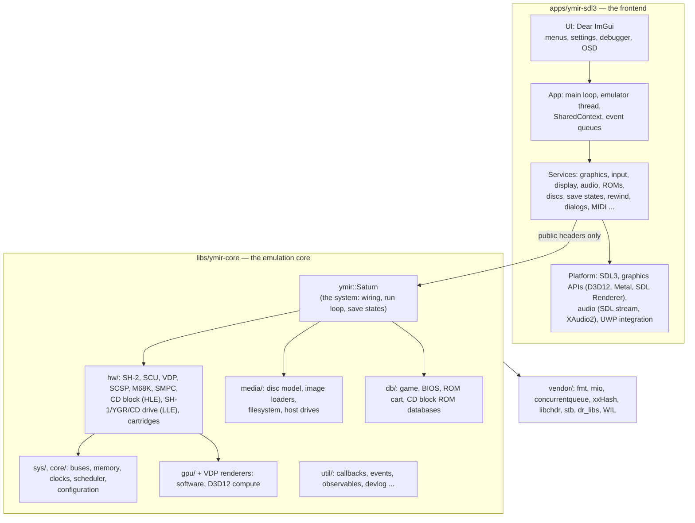
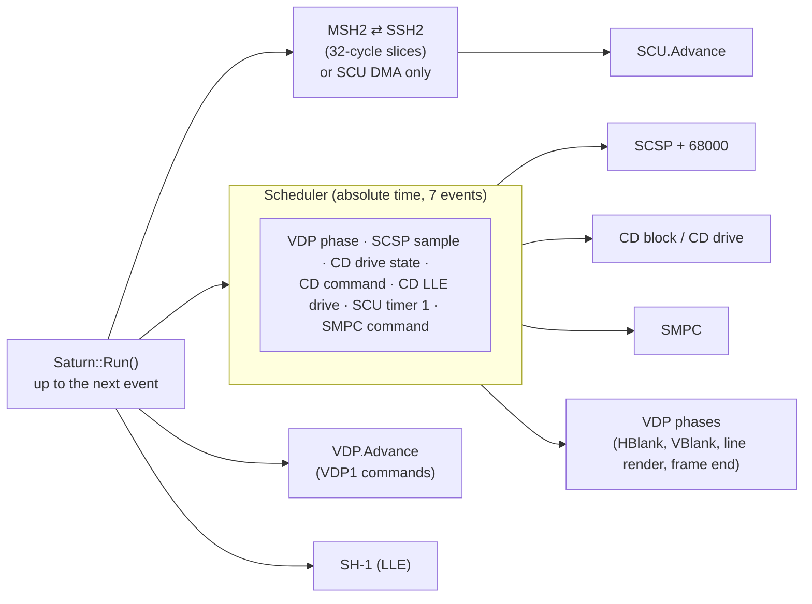
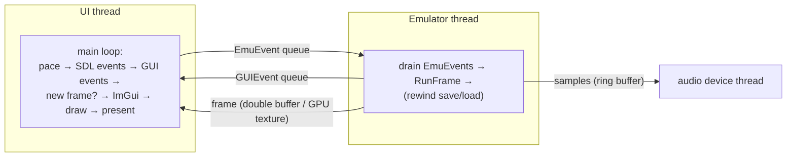
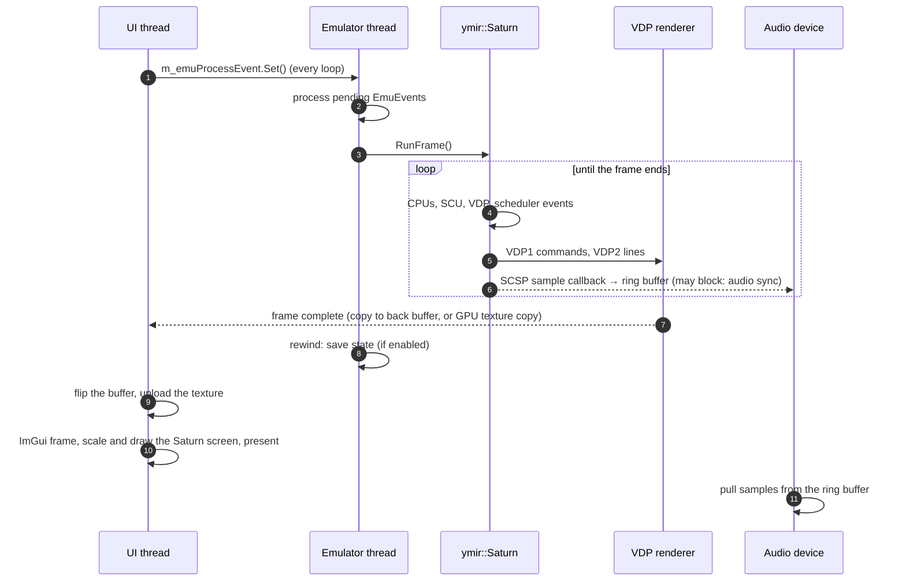

# Architecture

> Part of the [Ymir documentation](README.md). This is the map of the whole program. The pages linked from each
> section go into the details.

## Layers

The dependency direction is strict:

- **Frontend → core.** The core never includes frontend libraries: no SDL, no ImGui (CONTRIBUTING.md: "MUST NOT be
  included in `ymir-core`").
- **The core is self-contained.** Its dependencies are vendored, never taken from vcpkg, so it can be embedded in
  other projects with `Ymir_LIBRARY_ONLY=ON`.
- **Core → host** happens only through callbacks and plain interfaces:

  | Interface | Direction |
  |---|---|
  | Sample callback | Audio out |
  | Framebuffer or GPU texture callbacks | Video out |
  | Peripheral report callback | Input in |
  | Persist callback | SMPC data |
  | Tracer interfaces | Debugging |
  | Debug break callback | Debugging |

## Design rules that apply everywhere

These rules come from CONTRIBUTING.md and are visible throughout the code:

| Rule | Why | Example |
|---|---|---|
| No global or static mutable state | Several cores can run in one process ("parallel frame search") | Everything lives in `Saturn` or `App` objects |
| Components are wired by callbacks, not references | Loose coupling, testability | `Saturn`'s constructor wires SCU ↔ SH-2 ↔ VDP ↔ SMPC ↔ SCSP ↔ CD block |
| Errors as values, no exceptions | Predictable control flow | `util::Result`, `ValueResult`, `VoidResult` |
| Avoid `virtual` in hot paths | Performance | Template instantiations; virtuals only at coarse boundaries (renderers, cartridges, peripherals) |
| Accuracy first, but configurable when expensive | Correctness with acceptable speed | `Saturn`'s `<debug, cache, cdblockLLE>` function pointers; SH-2 `template <bool debug>` |
| OS-specific code only with fallbacks | Builds everywhere | `util::Event`: `WaitOnAddress`, futex, `_umtx_op`, or condition variable |
| Hot paths must be benchmarked | The interpreter and renderers dominate performance | SH-2 interpreter, SCU DSP, VDP software renderer, SCSP |

## The emulation core in one picture

`Saturn::RunFrame()` runs this loop until the VDP has finished a frame. See [core-system.md](core-system.md) for the
details of timing, buses and every chip.

## The frontend in one picture

The **UI thread** owns SDL, ImGui and the graphics context. The **emulator thread** owns the `Saturn` object. The
two communicate through lock-free event queues:

- **UI → emulator:** commands such as reset, load disc, save state or change setting are sent as events and executed
  *between frames*.
- **Emulator → UI:** notifications and dialogs travel the other way.
- **Video and audio** go through minimal-synchronization buffers.
- **The debugger** reads with side-effect-free *peeks* and sends its writes as events.

Details are in [frontend.md](frontend.md).

## The life of a frame

## Where things live

| I want to… | Look at |
|---|---|
| Understand a chip | [saturn-hardware.md](saturn-hardware.md), then `libs/ymir-core/include/ymir/hw/<chip>/` |
| Follow the run loop | `libs/ymir-core/src/ymir/sys/saturn.cpp` (`Run`, `RunFrameImpl`) |
| Change timing | `include/ymir/sys/clocks.hpp`, `include/ymir/core/scheduler.hpp`, `Saturn::ConfigureAccessCycles` |
| Touch rendering | `include/ymir/hw/vdp/renderer/` (software and D3D12), `res/shaders/` |
| Add a disc format | `include/ymir/media/loader/`, `media::LoadDisc` |
| Add a controller | `include/ymir/hw/smpc/peripheral/` (core), `apps/ymir-sdl3/src/app/input/` and `actions.hpp` (frontend) |
| Add a per-game fix | `libs/ymir-core/src/ymir/db/game_db.cpp` |
| Change a setting | `apps/ymir-sdl3/src/app/settings.{hpp,cpp}` (+ `Settings::BindConfiguration`) |
| Add a menu or window | `apps/ymir-sdl3/src/app/app.cpp` (main menu), `app/ui/windows/`, `WindowManagerService` |
| Add a debugger view | `apps/ymir-sdl3/src/app/ui/windows/debug/`, `ui/views/debug/`, and a tracer in `app/debug/` |
| Change the save state format | `apps/ymir-sdl3/src/serdes/cereal_savestate.hpp` (bump the version and document it) |
| Port to a new platform | [docs/uwp/README.md](../uwp/README.md) is a worked example (UWP/Xbox) |

## Extension points

- **VDP renderer:**
  - implement `IVDPRenderer`, or `HardwareVDPRendererBase` for GPU renderers;
  - add a `VDPRendererType`;
  - let `VDP::UseRenderer<T>` copy the callbacks.
- **Graphics context (frontend):**
  - implement `gfx::IGraphicsContext`;
  - add a `gfx::Backend` and wire it in `GraphicsService::CreateGraphicsContext`.
- **Audio output (frontend):** implement `app::AudioBackend` (pull-based), as the SDL and XAudio2 backends do.
- **Peripheral:**
  - add a peripheral class and type in the core;
  - in the frontend, add actions and bindings, an input state struct and `InputService::ReadPeripheral` support.
- **Disc image format:** add a loader to `media::LoadDisc`'s chain.
- **Tracer:** implement the matching `ymir::debug::I*Tracer` and attach it while debug tracing is enabled.
