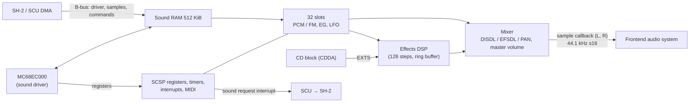

# Audio: SCSP and the MC68EC000

> Part of the [Ymir documentation](README.md). For what the hardware does, see
> [saturn-hardware.md](saturn-hardware.md#audio-scsp-and-mc68ec000). Paths are relative to `libs/ymir-core/` unless
> written out.

## Overview

The Saturn's sound subsystem is self-contained:

- **SCSP** (Saturn Custom Sound Processor, YMF292): **32 slots** (voices) of PCM and FM synthesis at 44.1 kHz, a
  128-step **effects DSP**, three timers, a MIDI interface, a DMA engine and **512 KiB of sound RAM**.
- **Motorola MC68EC000**: the sound CPU, which runs the sound driver out of that sound RAM.
- The SH-2s upload the driver and samples over the B-bus and talk to the driver through sound RAM. The CD block
  streams **CD audio** (CDDA) straight into the SCSP.

## SCSP (`include/ymir/hw/scsp/`, `src/ymir/hw/scsp/`)

### Constants

`scsp_defs.hpp` defines:

- 32 slots at 44 100 Hz, 16 SCSP cycles per slot and 512 per sample;
- an SCSP clock of 22 579 200 Hz, with 2 SCSP cycles per 68000 cycle.

### The slot pipeline

The design comment in `scsp.hpp` explains how a sample is computed: "The SCSP performs 7 operations in parallel on
7 different slots from i to i-6":

| Stage | Work |
|---|---|
| op1 | Phase and pitch LFO |
| op2 | X/Y modulation read and address |
| op3 | Waveform read |
| op4 | Interpolation, envelope generator and amplitude LFO |
| op5 | Amplitude LFO level |
| op6 | Total level |
| op7 | Sound stack write |

"RAM access is granted to DSP on cycles 0,1,4,5 and to slots on cycles 2,3,6,7". The DSP runs four program steps per
slot. `ProcessSlots` implements this pipeline.

### Features implemented

- **PCM:** 8-bit and 16-bit samples from sound RAM, plus noise and silence sources. Loop modes are off, normal,
  reverse and alternate. One-shot sample ends are handled (with emulation of a PCM end bug).
- **FM:** modulation through the 64-entry sound stack (MDL, MDXSL, MDYSL).
- **Interpolation:** linear or nearest. The comment says "Linear is accurate to the hardware".
- **Envelope generator:**
  - stages: attack, decay 1, decay 2, release;
  - EGHOLD, LPSLNK and the undocumented EGBYPASS;
  - the hardware "attack bug" (AR + KRS ≥ 0x20).
- **Pitch and amplitude LFOs.**
- **Mixing:**
  - direct (DISDL) and effect (EFSDL) send levels in 6 dB steps, and pan in 3 dB steps;
  - EFREG 0–15 and the CDDA inputs (EXTS 16–17) are mixed in;
  - the master volume is applied in 3 dB steps, the output is clamped to 16 bits and sent through the sample
    callback.
- **DSP:**
  - a 128-step program with TEMP, MEMS, COEF, MADRS, MIXS (double-buffered), EFREG and EXTS;
  - a ring buffer (RBP/RBL);
  - float/int memory conversion.
- **Timers:** A, B and C count every `1 << TxCTL` samples.
- **Interrupts:**
  - towards the SCU: the *sound request* interrupt;
  - towards the 68000: three level bits. A long comment explains the bit-parallel level selection.
- **DMA** between sound RAM and the registers.

### Stepping and threading

- **Step granularity.** The SCSP is ticked by a scheduler event. The granularity is configurable from one sample
  (32 slots, the default) down to one slot per event. A finer step syncs more closely with the CPUs at a
  performance cost.
- **Threaded SCSP** (`audio.threadedSCSP`, off by default):
  - The "SCSP thread" runs the slots, the DSP and the 68000.
  - The emulator thread posts a target slot step, and the SCSP thread catches up in the largest aligned step it can.
  - SH-2 writes are queued. SH-2 reads synchronize first.
  - Every frame ends with `SCSP.SyncSCSPThreadPublic()`.
  - CONTRIBUTING.md notes that "threaded VDP1 and SCSP might" cause issues, unlike threaded VDP2 and deinterlacing.

### CD audio

- `ReceiveCDDA(sector)` fills a 15-sector ring and starts playback once 4 sectors are buffered. On underrun it
  outputs silence.
- It returns how full the buffer is, in thirds. The CD block uses that value to pace the drive:
  - under 1/3 full, it runs 25 % faster;
  - at 2/3 or more, it runs 25 % slower.

### MIDI

- **Input:** `ReceiveMidiInput` schedules messages in sample time into a 1 KiB FIFO. "TODO: I believe MIDI stuff is
  *supposed* to trigger interrupts... however there are no commercial games relying on this behavior".
- **Output:** bytes written by the 68000 are assembled into packets and flushed through a callback. The frontend
  routes both directions through RtMidi.

## MC68EC000 (`include/ymir/hw/m68k/`)

- An interpreter dispatches through a 64K-entry decode table. Each instruction returns its cycle count.
- The prefetch queue is modelled ("IR is omitted for performance").
- The SCSP itself is the 68000's bus (`using M68kBus = scsp::SCSP`): WRAM at `0x000000–0x07FFFF`, registers at
  `0x100000–0x1FFFFF`.
- It runs before each SCSP step, and the SMPC commands SNDON/SNDOFF turn it on and off.
- The game database can double its speed (`FastMC68EC000`) for games that need it.

## Into the frontend

The core calls the sample callback once per output sample, on the emulator thread or the SCSP thread. In
`ymir-sdl3`:

1. `AudioSystem::ReceiveSample` writes the sample into a 2048-frame ring buffer. When audio sync is on, it blocks
   while the ring is full. This is what paces emulation at 100 % speed.
2. The audio device (an SDL audio stream on desktop, XAudio2 on UWP/Xbox) pulls frames with `FillFrames`, applying
   gain and mute and repeating data when the ring runs dry.

The diagram and details are in [frontend.md](frontend.md#audio).
