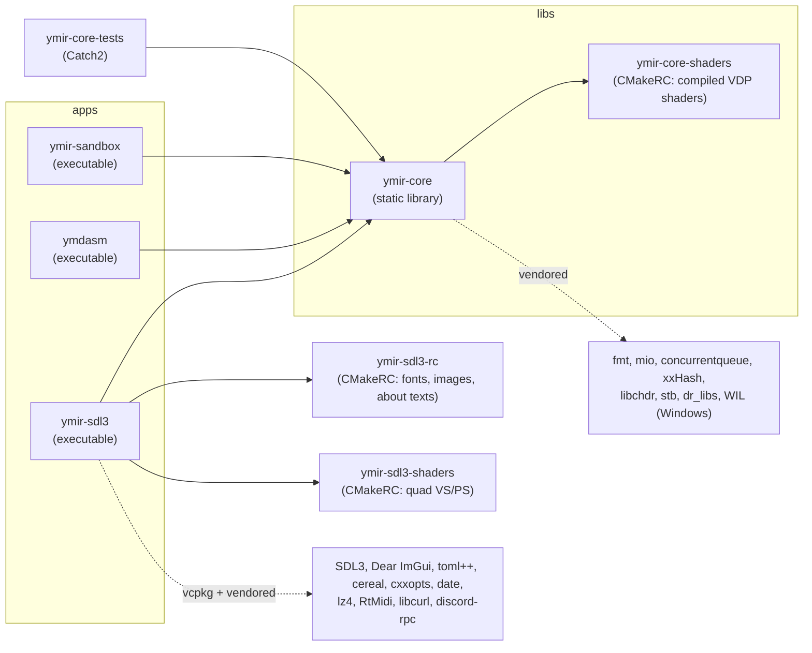
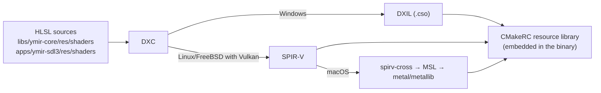

# Building, testing and the repository layout

> Part of the [Ymir documentation](README.md). For step-by-step build instructions per platform see
> [COMPILING.md](../../COMPILING.md); this page explains how the build is put together.

## Repository layout

```
Ymir/
├── apps/                    Executables
│   ├── ymir-sdl3/           The emulator frontend (SDL3 + Dear ImGui)
│   ├── ymdasm/              Disassembler CLI for SH-2, M68000, SCU DSP and SCSP DSP code
│   └── ymir-sandbox/        Prototyping sandbox (not packaged)
├── libs/
│   └── ymir-core/           The emulation core (static library)
│       ├── include/ymir/    Public headers: core, db, debug, gpu, hw, media, savestate, sys, util
│       ├── src/ymir/        Implementation
│       ├── res/shaders/     HLSL compute shaders for the hardware VDP renderer
│       └── docs/            Doxygen main page and namespace descriptions
├── tests/
│   └── ymir-core-tests/     Catch2 unit tests (SCU DSP, SH-2, VDP)
├── vendor/                  Third-party code: Git submodules and source trees
├── cmake/                   CMake modules, preset building blocks (config/) and presets (presets/)
├── vcpkg/                   vcpkg (submodule) used by the frontend and tools
├── vcpkg-triplets/          Custom static triplets (LLVM/MSVC, AVX2/LTO/sanitizer variants)
├── vcpkg-overlay-ports/     Overlay ports (uwp/: rtmidi dummy backend, header-only tomlplusplus)
├── scripts/uwp/             UWP/Xbox build, package and deploy scripts (this fork)
├── docs/                    Documentation (this folder, dev-notes/, uwp/)
└── .github/workflows/       CI
```

## Targets and how they depend on each other



| Target | Kind | Links (main ones) |
|---|---|---|
| `ymir-core` (`ymir::ymir-core`) | static library, always static | `ymir-core::shaders`, `fmt`, `mio`, `concurrentqueue`, `xxHash`, `chdr-static`, `stb`, `dr_libs`; on Windows `d3d12`, `dxgi`, `dxguid`, `WIL` (+ `synchronization`, `dxcompiler` outside UWP); `Iconv` on Apple/Unix; Vulkan privately if found |
| `ymir-sdl3` | executable | `ymir-core`, SDL3, Dear ImGui, `tomlplusplus`, `cereal`, `cxxopts`, `date`, `fmt`, `lz4`, `RtMidi`, `stb`, `dr_libs`; optional `discord-rpc` and `libcurl`; `WIL` (+ `Dwmapi` outside UWP) on Windows; `xaudio2` on UWP |
| `ymdasm` | executable | `ymir-core`, `cxxopts` |
| `ymir-sandbox` | executable | `ymir-core`, SDL3, `date`, `fmt`, `libcurl`, `nlohmann_json`, `stb` |
| `ymir-core-tests` | executable | `ymir-core`, `fmt`, `Catch2::Catch2WithMain` (registered with `catch_discover_tests`) |

## Dependency policy

The core must stay embeddable, so its dependencies are restricted (see [CONTRIBUTING.md](../../CONTRIBUTING.md) and
`vendor/CMakeLists.txt`):

- **`ymir-core` never uses vcpkg.** Everything it needs is a Git submodule or a source tree under `vendor/`. This is
  what allows it to be consumed as a subproject with `Ymir_LIBRARY_ONLY=ON` (via `add_subdirectory` or
  `FetchContent`).
- **Frontend libraries never leak into the core:** no SDL, ImGui, Qt, GLFW, etc. in `libs/ymir-core`.
- Other targets prefer submodules or FetchContent, and use vcpkg for complex dependencies.
- Builds must not need manual steps.

| Vendored library | Used by | Purpose |
|---|---|---|
| `mio` | core | Memory-mapped files (disc images, backup RAM). This fork points at a branch with UWP `*FromApp` APIs |
| `fmt` | core, frontend | Formatting |
| `concurrentqueue` | core, frontend | Lock-free queues (event queues between threads) |
| `xxHash` | core | Hashing (e.g. game identification) |
| `libchdr` | core | MAME CHD disc images |
| `stb` | core, frontend | `stb_image`, `stb_image_write`, `stb_vorbis` |
| `dr_libs` | core, frontend | `dr_flac`, `dr_mp3`, `dr_wav` (audio tracks in CUE sheets) |
| `wil` | core, frontend (Windows) | Windows Implementation Library (COM smart pointers, handles) |
| `imgui` | frontend | Dear ImGui (docking branch) with the SDL3, SDLRenderer3, DX11/DX12, Metal and Vulkan backends |
| `lz4` | frontend | Fast compression (rewind buffer); vendored to control AVX2 |
| `discord-rpc` | frontend | Discord Rich Presence |
| `SDL3-uwp` | UWP frontend only | SDL3 with the WinRT backend; built out of tree by `scripts/uwp/build-deps.ps1` |

vcpkg dependencies (`vcpkg.json`): catch2, cereal, curl, cxxopts, date, neargye-semver, nlohmann-json, openssl,
rtmidi, sdl3, tomlplusplus, zlib, zstd, miniz. Several are `!uwp`.

## CMake options

| Option | Default | Effect |
|---|---|---|
| `Ymir_DEV_BUILD` | ON | Development build (affects version string and defaults below) |
| `Ymir_ENABLE_DEVLOG` | `Ymir_DEV_BUILD` | Compile in the development log (`devlog::*`) |
| `Ymir_ENABLE_DEV_ASSERTIONS` | OFF | Extra assertions in the core |
| `Ymir_EXTRA_INLINING` | top-level project | Aggressive forced inlining in hot paths |
| `Ymir_ENABLE_IPO` | ON | Link-time optimization |
| `Ymir_AVX2` | OFF (x86-64 only) | Build with AVX2/FMA/BMI; ARM64 always uses NEON |
| `Ymir_ENABLE_TESTS`, `Ymir_ENABLE_SANDBOX`, `Ymir_ENABLE_YMDASM` | top-level project | Build the respective targets |
| `Ymir_ENABLE_IMGUI_DEMO` | ON | Include the ImGui demo window |
| `Ymir_ENABLE_UPDATE_CHECKS` | ON | Offer update checks in the frontend |
| `Ymir_LIBRARY_ONLY` | OFF at top level, forced ON as a subproject | Build only `ymir-core` |
| `Ymir_ENABLE_DISCORD_RPC` | ON (OFF on UWP) | Discord Rich Presence |
| `Ymir_ENABLE_UPDATE_CHECKER` | ON (OFF on UWP) | Update checker (needs libcurl) |
| `Ymir_PGO` | OFF | `GENERATE` / `USE` profile-guided optimization (Clang, GCC) |

Feature flags:

- `Ymir_FF_HOST_CD_DRIVES` (host optical drives) defaults to ON only for local builds.
- `Ymir_FF_ENABLE_UNIMPL_GFX_BACKENDS` exposes the unfinished D3D11 and Vulkan graphics contexts and also defaults to
  local builds only.

The core exports public macros that the frontend relies on:

- version and build: `Ymir_VERSION*`, `Ymir_{DEV,NIGHTLY,STABLE,LOCAL}_BUILD`;
- `Ymir_ENABLE_DEVLOG` and `Ymir_DEV_ASSERTIONS`;
- platform: `YMIR_PLATFORM_HAS_DIRECT3D`, `YMIR_PLATFORM_HAS_VULKAN`, `YMIR_PLATFORM_HAS_METAL`;
- `YMIR_PLATFORM_UWP` (this fork) and `Ymir_AVX2`.

## Presets

`CMakePresets.json` only includes `cmake/presets/*.json`. Those presets are composed from building blocks in
`cmake/config/`:

| Building block | Contents |
|---|---|
| `arch-x86_64.json` | x64, with SSE2 or AVX2 variants |
| `build.json` | `full` (vcpkg toolchain, all targets) and `libonly` |
| `compiler-clang-cl.json`, `compiler-msvc.json` | Toolchain and vcpkg triplet |
| `generator-ninja.json`, `platform-windows.json` | Generator and host platform |
| `platform-uwp.json` | Visual Studio 2026 generator, `CMAKE_SYSTEM_NAME=WindowsStore`, `x64-uwp-static-md` triplet, UWP overlay ports, desktop-only features off |
| `targets.json` | Debug, Release (RelWithDebInfo with devlog and assertions) and Release-Dist (no devlog/assertions, extra inlining) |

Main presets:

- `Full-x86-64-{AVX2,SSE2}-{Clang,MSVC}-{Debug,Release,Release-Dist}`, plus Clang PGO variants;
- `LibOnly-...`;
- `UWP-x86-64-AVX2-MSVC` (and its `-VS2022` fallback) with the build presets `...-Debug` / `...-Release`;
- work-in-progress ARM64, Linux and macOS presets under `cmake/presets/wip/`.

## Shaders

The hardware renderer and the frontend's quad renderer use HLSL compiled at build time by
`cmake/CompileShaders.cmake`:



- DXC is required on Windows. glslc is not supported, because the shaders use 64-bit integers.
- On UWP the Windows SDK's DXC is preferred because it produces **signed** DXIL; the app then needs no runtime
  shader compiler.
- Core shaders:
  - compute shaders built as `cs_6_0` with entry point `CSMain`: VDP1 erase, VDP1 framebuffer RAM write, VDP1
    polygon drawing, VDP1 output merger, VDP2 background rendering, VDP2 sprite rendering and VDP2 compose;
  - the polygon and merger shaders come in variants selected by `POLYSPEC_*` macros (transparent mesh × shading or
    merge mode).
- Frontend shaders: `gctx/quad_vs.hlsl` (`vs_6_0`) and `quad_ps.hlsl` (`ps_6_0`), used to draw textures to the screen.

## Embedded resources

[CMakeRC](https://github.com/vector-of-bool/cmrc) bundles files into the executable:

- `ymir-sdl3-rc` holds fonts (Spline Sans, Spline Sans Mono, M PLUS U, Zen Dots, Material Symbols), `images/ymir.png`
  and the About texts.
- `ymir-core-shaders` and `ymir-sdl3-shaders` hold the compiled shaders.

## Tests

- `tests/ymir-core-tests` uses Catch2 with `TEST_CASE_PERSISTENT_FIXTURE` fixtures. It covers:
  - the SCU DSP: ALU, instructions, loops, end instructions, DMA;
  - the SH-2: disassembler, DIVU, interrupt controller (flow, priorities, level masks, delay slots), MAC.W/MAC.L;
  - VDP2 VRAM access patterns.
- Run them with:

  ```powershell
  cmake --preset Full-x86-64-AVX2-MSVC-Release
  cmake --build out\build\Full-x86-64-AVX2-MSVC-Release
  ctest --test-dir out\build\Full-x86-64-AVX2-MSVC-Release --output-on-failure -j 8
  ```

- Tests are off when the core is a subproject and in the UWP preset. Upstream CI builds but does not run them.

## Documentation of the API

`Doxyfile` generates HTML API docs for the public core headers (`libs/ymir-core/include`) into `out/docs`
(`doxygen Doxyfile`). No CMake target runs it.

## Continuous integration

| Workflow | Purpose |
|---|---|
| `ci.yaml` | Build matrix on push: Windows x64/ARM64, Linux x64/ARM64, FreeBSD, macOS; full and library-only |
| `build.yaml` | Reusable release build (called by the workflows below) |
| `pr-builds.yaml` | Builds pull requests |
| `nightly-release.yaml` | Daily `latest-nightly` release when there are new commits |
| `stable-release.yaml` | Releases on `v*` tags |
| `screenshotter.yaml` | Triggers the external compatibility screenshotter |
| `uwp.yml` | **This fork:** UWP/Xbox package on `uwp/**` pushes, `uwp-v*` tags and manual runs |

On the `uwp/main` fork only `uwp.yml` is enabled; see [docs/uwp/README.md](../uwp/README.md).

## Known discrepancies in COMPILING.md

These were found while writing this page. They are worth fixing upstream.

- `Ymir_FEATUREFLAG_DEFAULT` is documented but does not exist.
- COMPILING.md says `Ymir_FF_HOST_CD_DRIVES` is disabled by default, but it actually defaults to ON for local builds.
- `Ymir_EXTRA_INLINING` defaults to ON for top-level builds, not OFF.
- `Ymir_FF_ENABLE_UNIMPL_GFX_BACKENDS`, `Ymir_ENABLE_DISCORD_RPC` and `Ymir_ENABLE_UPDATE_CHECKER` are not documented.
