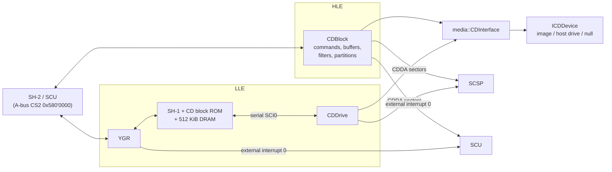
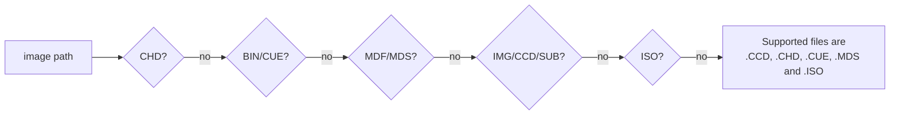

# CD block, disc images and backup memory

> Part of the [Ymir documentation](README.md). For what the hardware does, see
> [saturn-hardware.md](saturn-hardware.md#cd-subsystem). Paths are relative to `libs/ymir-core/` unless written out.

## Two ways to emulate the CD block

On real hardware the CD block is a small computer of its own:

- a Hitachi **SH-1** CPU running a ROM, with 512 KiB of DRAM;
- the **YGR** gate array, which bridges it to the main system;
- the **CD drive** mechanism, attached over a serial link.

Games talk to it through a register interface (commands, responses, HIRQ flags) and a data FIFO. Ymir offers two
implementations and picks one at runtime:

| | HLE (`cdblock::CDBlock`) | LLE (SH-1 + YGR + CD drive) |
|---|---|---|
| What runs | A C++ reimplementation of the CD block's command set | The real CD block ROM on an emulated SH-1 |
| Requires | Nothing | A CD block ROM image in `roms/cdb/` |
| Accuracy | Good, with documented hacks | Higher, but slower |
| Setting | Default | `cdblock.useLLE` — "Causes a hard reset when changed" |

`Saturn::SetCDBlockLLE` remaps the bus to `YGR` or `CDBlock`, switches the run-function template and hard-resets.
There is a TODO to rename `CDBlock` to `CDBlockHLE` and group the LLE parts.

## HLE CD block (`include/ymir/hw/cdblock/`, `src/ymir/hw/cdblock/cdblock.cpp`)

- **Mapping:** the registers are mirrored every 64 bytes within 4 KiB blocks across `0x580'0000–0x58F'FFFF`. "32-bit
  reads from 589'0000 trigger the FIFO once".
- **Timing:** there are two scheduler events, the periodic drive state and command execution (50 cycles after a
  command is issued). The 20 MHz clock is counted in thirds to avoid rounding. "Serial data transfer timings adapted
  from Yabause".
- **Buffers, filters and partitions:**
  - 200 sector buffers, 24 filters and 24 partitions. A design comment describes how the CD drive, the host and MPEG
    devices connect through filters' pass and fail outputs.
  - Filters test file number, channel, submode, coding info and frame-address range, with an invert option.
- **Commands:**

  | Code | Commands | Status |
  |---|---|---|
  | 0x00–0x06 | Status, hardware info, TOC, session, init, open tray, end transfer | Implemented |
  | 0x10–0x12 | Play, seek, scan | Implemented |
  | 0x20 | Subcode Q | Implemented; the R-W transfer is not |
  | 0x30–0x32 | Device connections | Implemented |
  | 0x40–0x48 | Filters | Implemented |
  | 0x50–0x54 | Buffer information | Implemented |
  | 0x55/0x56 | FAD search | Unimplemented |
  | 0x60–0x64 | Sector length, get, delete, get-then-delete, put | Implemented |
  | 0x65/0x66 | Copy/move sector data | Unimplemented |
  | 0x67 | Copy error | Implemented |
  | 0x70–0x75 | Filesystem: change directory, read directory, file info, read file | Implemented |
  | 0x90–0xAF, 0xE2 (MPEG) | MPEG card | Stubs (MPEG init only reports success) |
  | 0xE0/0xE1 | Authentication | Always succeed (`m_discAuthStatus = 4; // always authenticated ;)`) |

- **Drive model:**
  - The read speed factor is configurable from 2× (the real drive) up to 200×.
  - The seek time is fixed at a few ticks. "Digital Dance Mix Vol. 1 - Namie Amuro -- requires at least 5 seek
    ticks".
  - Several state transitions carry documented hacks for boot-sequence and test-ROM quirks.
- **CD audio:** audio sectors go to the SCSP. Scanning attenuates the volume by 12 dB. The drive is paced by the
  SCSP's buffer fill.

## LLE CD block

| Part | What it is |
|---|---|
| `sh1::SH1` | The CD block CPU, on its own `SH1Bus`. It runs a 64 KiB ROM (checked in save states), with the 512 KiB DRAM at `0x1000000`/`0x9000000`. Peripherals: AD, BSC, DMAC, INTC, ITU, PFC, SCI, TPC, WDT. The main loop advances it by clock ratio |
| `cdblock::YGR` | The host interface: command/response registers, HIRQ and mask, and a 6-word data FIFO (the only device that stalls the bus). It drives SH-1 IRQ6/IRQ7 and DREQ0/1, and SCU external interrupt 0 |
| `cdblock::CDDrive` | The drive mechanism's serial protocol with the SH-1: COMSYNC/COMREQ, 13-byte command and status frames. Commands: continue, seek, read TOC, stop, read sector, pause, scan. Some fields are marked "// guess" |

## The media layer (`include/ymir/media/`)

### CD devices

`media::CDInterface` holds the current `ICDDevice` and calls `Saturn::OnMediaChanged` whenever it changes:

| Device | Use |
|---|---|
| `NullCDDevice` | No disc (default, and after eject) |
| `ImageCDDevice` | A loaded disc image; seeks are instant |
| `HostCDDevice` | A physical drive (feature flag `Ymir_FF_HOST_CD_DRIVES`): a worker thread, a sequential prefetcher and an LRU sector cache, using raw SCSI commands. Backends: Windows (`IOCTL_SCSI_PASS_THROUGH_DIRECT`), Linux (`SG_IO`); macOS is a stub |

`ICDDevice` reads full 2352-byte sectors, synthesizing missing parts, or 2048-byte user data. Its save-state design
"avoids reexecuting seeks to minimize strain on real hardware".

### Disc model (`disc.hpp`)

- A `Disc` has sessions and the Saturn header. A `Session` has up to 99 tracks and a synthesized TOC.
- Each `Track` has a binary reader, a sector size, a control/ADR byte (data or audio), FAD ranges and indices.
- Images with 2048-, 2336- or 2340-byte sectors get their sync, header and ECC **synthesized**.
- Binary readers can be a file, a memory map (`mio`, the default) or a buffer in memory (when *preload to RAM* is
  enabled). There are also composite, sub-view and zero readers.

### Image loaders

`media::LoadDisc(path, disc, preloadToRAM, cbMsg)` tries each format in turn:

| Format | Notes |
|---|---|
| CHD | MAME compressed hunks via libchdr. Optional precache. Audio is big-endian. The hunk cache never evicts |
| BIN/CUE | MODE1/MODE2 RAW and 2048/2324/2336/2352, AUDIO, CDG; PREGAP/POSTGAP. Audio tracks can be **WAVE** (16-bit stereo 44.1 kHz), **MP3** or **OGG**. MP3 and OGG are decoded into RAM and resampled to 44.1 kHz by linear interpolation, which "just preserves the retro feel" |
| MDF/MDS | Alcohol 120 % ("based on reverse-engineering work by Henrik Stokseth") |
| IMG/CCD/SUB | CloneCD, multi-session; "Scrambled blocks are not supported" |
| ISO | 2048- or 2352-byte sectors; one data track at FAD 150 |

### Filesystem and identity

- `fs::Filesystem` reads the ISO 9660 volume descriptors, path table and directories. The CD block's filesystem
  commands use it.
- The **disc hash** is XXH3-128 over sectors 150–165 plus the volume descriptors. It identifies a disc for:
  - save states, which must match;
  - per-game save states and backup RAM;
  - the game database.
- **`SaturnHeader`** is the 256-byte header at the start of the disc, and is valid only if it says
  `"SEGA SEGASATURN"`. It holds the maker, product number, version, release date, compatible areas (J, T, U, B, K, A,
  E, L), peripherals, title and the boot program's addresses. It drives region autodetection and the game database
  lookup.

## Backup memory (`include/ymir/sys/backup_ram.hpp`)

Saturn games save to battery-backed **backup RAM**: 32 KiB inside the console, or a backup cartridge.

| Size | Block size |
|---|---|
| 32 KiB (internal, 256 Kbit) | 64 bytes |
| 512 KiB, 1 MiB, 2 MiB (4/8/16 Mbit cartridges) | 512 bytes |
| 4 MiB (32 Mbit) | 1024 bytes |

- **Format:** the "BackUpRam Format" header is repeated through the first block. Interleaved images ("FF xx FF xx
  …", twice the size) are detected and handled.
- **Files:** each file has an 11-character name, a 10-character comment, a language and a date in "minutes since
  01/01/1980". The API lists, exports, imports (with overwrite handling), deletes and formats them. The frontend's
  backup memory manager window is built on it.
- **Storage:** in memory, a memory-mapped file, or a copy-on-write map that "preserves original file contents".
- **Where the frontend keeps the files:** the internal backup RAM goes to `state/bup-int.bin`, or one file per game
  (`backup/games/bup-int-<game>.bin`) when that option is on. Cartridge images are configured in the settings.
