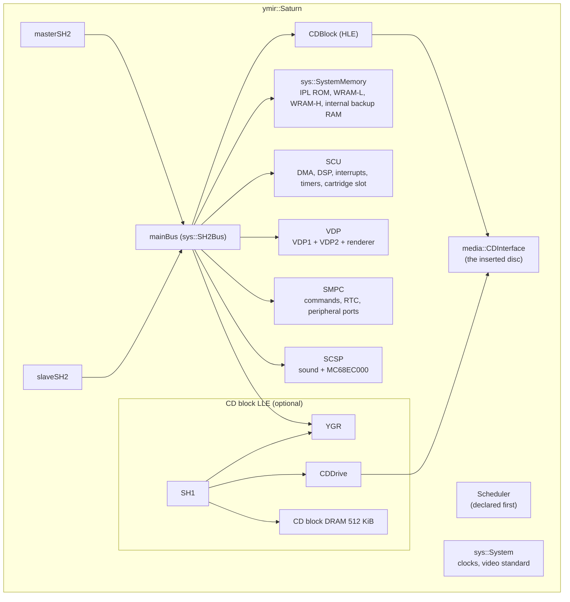
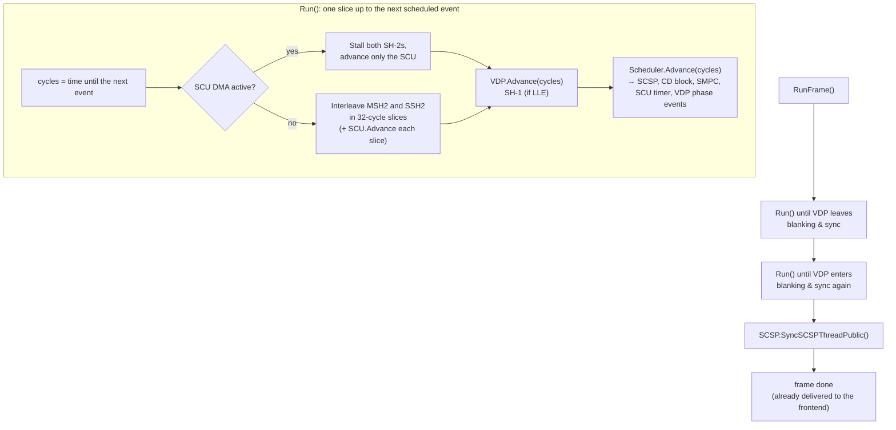

# The emulation core: system side

> Part of the [Ymir documentation](README.md). This page covers `ymir::Saturn`, timing, buses, the CPUs and the
> system chips. Video, audio and the CD subsystem have their own pages: [video.md](video.md), [audio.md](audio.md),
> [cd-and-media.md](cd-and-media.md). Paths are relative to `libs/ymir-core/` unless written out.

## Design principles

The core lives in `libs/ymir-core`. It is a static library that "deals exclusively with Sega Saturn emulation and
providing platform-agnostic input, output and control interfaces" (CONTRIBUTING.md). Its rules shape everything below:

- **No global state.** Every piece of state lives in objects, so several `Saturn` instances can coexist in one process.
  CONTRIBUTING.md gives the reason: "you can run multiple emulator cores in a single process for advanced features
  like parallel frame search".
- **Components never reference each other directly.** They expose `util::RequiredCallback` / `OptionalCallback`
  members: a C function pointer plus a context, built with `util::MakeClassMemberRequiredCallback<&T::Fn>(this)`.
  `Saturn` wires them all together.
- **No exceptions.** Errors are returned as values.
- **Little `virtual` in hot paths.** Composition is preferred over inheritance.
- **Accuracy over performance, unless it is very costly.** In that case the option is configurable at runtime, and
  separate code paths are generated as template instantiations.
- **The core is not thread-safe, and the docs say it never will be.** The frontend drives it from one thread. The
  optional VDP and SCSP worker threads are internal and synchronized with it (`docs/mainpage.hpp`).

## `ymir::Saturn`: the system object

`include/ymir/sys/saturn.hpp` is the facade. The umbrella header `ymir/ymir.hpp` includes it together with the
version and the disc loader.

### Construction

The constructor (`src/ymir/sys/saturn.cpp`) does the following:

1. It maps the whole main bus (and the SH-1 bus) to "unhandled access" log handlers first, so that every real device
   then maps itself over that default.
2. It wires the callbacks:

   | From | To | What |
   |---|---|---|
   | SCU | SH-2 | IRL interrupts |
   | Master SH-2 | SCU | Interrupt acknowledge. "Slave SH2 IVECF# pin is not connected", so only the master acknowledges |
   | VDP | SCU | HBlank, VBlank and sprite-draw-end interrupts |
   | VDP | SMPC | VBlank IN and the optimized INTBACK read |
   | SMPC | SCU | System Manager and PAD interrupts |
   | SMPC | VDP | External latch (light gun) |
   | SCSP | SCU | Sound request interrupt |
   | CD block | SCU | External interrupt 0 |
   | CD block | SCSP | CDDA audio |
   | SH-1, YGR, CD drive | each other | The LLE wiring |

3. It registers clock-change observers (SCSP, SMPC, CD drive, CD block) with `sys::System`.
4. It maps memory in a fixed order: system memory → MSH2 → SSH2 → SCU → VDP → SMPC → SCSP → CD block (HLE `CDBlock`
   or LLE `YGR`).
5. It binds the global cycle counter and the cache option into both SH-2s, then performs a hard reset.

### Run-function dispatch

`RunFrame()`, `StepMasterSH2()` and `StepSlaveSH2()` go through member-function pointers. These are chosen from the
2³ template instantiations of `<debug, enableSH2Cache, cdblockLLE>`, using a recursive helper that "convert[s]
runtime parameters into compile-time constants". The hot loop therefore never tests these options. CONTRIBUTING.md
cites this as the canonical pattern for configurable accuracy.

### Region and per-game settings

- `AutodetectRegion()` picks an SMPC area code from the disc header's compatible-area bitmap and the preferred region
  order. It switches the video standard to match: areas 1/2/4/5/6 are NTSC, A/C/D are PAL. If the area changed, it
  hard-resets.
- `OnMediaChanged()` looks the disc up in the game database (`db::GetGameInfo(productNumber, discHash)`) and applies
  the per-game workarounds: fast bus timings, forced SH-2 cache emulation, a faster 68000, and VDP1/VDP2 quirk flags.
  Required cartridges are applied by the frontend, not the core.

## Timing: the scheduler and the clocks

### Clocks

`include/ymir/sys/clocks.hpp` documents the clock tree:

| Clock | NTSC | PAL | Drives |
|---|---|---|---|
| Master, 320 mode | 26.846591 MHz | 26.660156 MHz | Both SH-2s, VDP1, VDP2, SCU |
| Master, 352 mode | 28.636364 MHz | 28.4375 MHz | (320 mode = 352 mode × 15/16) |
| SCU DSP | master / 2 | master / 2 | |
| SCSP | 22.5792 MHz | 22.5792 MHz | Sound; the MC68EC000 runs at half of it |
| CD block SH-1 | 20 MHz | 20 MHz | |
| SMPC | 4 MHz | 4 MHz | |
| RTC | 32768 Hz | 32768 Hz | "but this emulator updates it at 1 Hz" |

- A frame is 455 × 525 × 2 master cycles (NTSC) or 455 × 625 × 2 (PAL).
- `ClockRatios` stores exact, minimized ratios of every other clock to the master clock. They are indexed by
  `(PAL << 1) | clock352`.
- The SH-2 clock factor ("overclock", clamped to 25 %–10 000 %) works by stretching every non-master ratio. The
  clamp exists because "The SH2 starts to choke on interrupts if it runs too slowly and … a 2.8 GHz SH2 is already
  too much to emulate, let alone two of them".

### The scheduler

`include/ymir/core/scheduler.hpp`. Events use absolute timestamps on one counter, and the nearest deadline is cached:
"the scheduler precomputes the closest deadline … so that it can run unimpeded by events for as many cycles as
possible".

- There is a fixed array of 7 events. Each has a target, a per-event count factor (its own clock ratio), a context
  and a callback.
- Events are single-shot unless the callback calls `EventContext::Reschedule(interval)`, which is relative to the
  previous deadline.
- Event IDs are stable because save states reference them:

  | ID | Event |
  |---|---|
  | `0x10` | VDP phase |
  | `0x20` | SCSP sample |
  | `0x30` | CD block drive state |
  | `0x31` | CD block command |
  | `0x32` | CD block LLE drive state |
  | `0x40` | SCU Timer 1 |
  | `0x50` | SMPC command |

### The run loop

- `Run()` executes exactly up to the next scheduled event. A compile-time switch, `max_timing_granularity`, uses
  1-cycle slices instead; the comment says it "Maximizes component synchronization at a massive cost to performance".
- The two SH-2s run interleaved in `kSH2SyncMaxStep = 32`-cycle slices. Overshoot is carried over in spillover
  counters.
- The SCSP and 68000, the CD block, the CD drive, the SMPC and SCU Timer 1 are "ticked by the scheduler".
- `StepMasterSH2()` / `StepSlaveSH2()` step one instruction and advance everything else by the same amount; the
  debugger uses them.
- Bus access timings (`Saturn::ConfigureAccessCycles`) are per-page read/write costs. The defaults are a compromise:
  "Virtua Fighter 2 -- sound effects go missing if the SH-2 runs too fast; Resident Evil -- can't go past title screen
  if timings are too slow". A cycle-accurate table is present but commented out, as "too slow in practice due to
  inaccurate SH2 cache, write buffer and BSC emulation".

## Buses and the memory map

`include/ymir/sys/bus.hpp` defines `sys::Bus<addressBits, pageGranularityBits>`, a page table:

- **Pages** are either fast arrays (direct pointers) or handler functions: read and write for 8, 16 and 32 bits,
  plus a "bus wait" predicate and per-size access cycles.
- **`Peek`/`Poke`** "bypass restrictions and don't cause any side-effects. These are meant to be used by debuggers."
- **Endianness and alignment:** reads and writes are aligned to the access size, and arrays are big-endian.
- **Instances:** `SH2Bus = Bus<27, 16>` (the main bus) and `SH1Bus = Bus<28, 19>` (the LLE CD block).
- **A-bus, B-bus and C-bus** exist only as address ranges and as the SCU's `BusID`. There are no separate bus objects.

The main bus as the devices map it:

| Address | Contents |
|---|---|
| `0x000'0000–0x00F'FFFF` | IPL (BIOS) ROM, 512 KiB, mirrored |
| `0x010'0000–0x017'FFFF` | SMPC registers |
| `0x018'0000–0x01F'FFFF` | Internal backup RAM (32 KiB) |
| `0x020'0000–0x02F'FFFF` | Low work RAM (1 MiB) |
| `0x030'0000–0x03F'FFFF` | Reads all ones (unmapped on VA0/VA1 boards; a mirror of low WRAM on VA2 — TODO "make this configurable") |
| `0x100'0000–0x17F'FFFF` | MINIT / SINIT: writes trigger the *other* SH-2's FRT input capture (inter-CPU signalling) |
| `0x200'0000–0x4FF'FFFF` | A-bus CS0/CS1: cartridge (32-bit accesses split into 2 × 16-bit), cartridge ID |
| `0x580'0000–0x58F'FFFF` | A-bus CS2: CD block (HLE `CDBlock` or LLE `YGR`) |
| `0x5A0'0000–0x5A7'FFFF` | B-bus: SCSP sound RAM (512 KiB) |
| `0x5B0'0000–0x5BF'FFFF` | B-bus: SCSP registers |
| `0x5C0'0000–0x5FB'FFFF` | B-bus: VDP1 VRAM, framebuffer, registers; VDP2 VRAM, CRAM, registers |
| `0x5FE'0000–0x5FE'FFFF` | SCU registers |
| `0x600'0000–0x7FF'FFFF` | High work RAM (1 MiB), mirrored |

`sys::SystemMemory` holds the IPL ROM, both WRAMs and the internal backup RAM. Without a BIOS, the IPL is a small
built-in "null program" that idles in `SLEEP`. The same program is the default SH-1 ROM.

## SH-2 CPUs (Hitachi SH7604)

`include/ymir/hw/sh2/` and `src/ymir/hw/sh2/sh2.cpp`. One class serves both CPUs: `BCR1.MASTER` decides the role and
the MINIT/SINIT mapping. The slave is enabled by the SMPC commands SSHON/SSHOFF.

### Interpreter

There is no JIT; the comment "TODO: choose between interpreter (cached or uncached) and JIT recompiler" is still
open.

- **`Advance<debug, emulateCache>(cycles)`** catches up the WDT and FRT to the global counter and returns early
  while the CPU sleeps. It then interprets instructions up to the target. In debug mode it also checks for illegal
  and unaligned PCs, breakpoints and watchpoints.
- **`InterpretNext`:**
  - It services interrupts first, through a packed 16-bit pending/allow compare. "All LDC, LDS, STC and STS
    instructions block interrupts on the following instruction."
  - It fetches through a 32-bit prefetch pair ("The CPU always does aligned 32-bit instruction fetches pulling in a
    pair of 16-bit instructions").
  - It dispatches through `DecodeTable::opcodes[delaySlot][instr]`: a precomputed 2 × 65536 table, where the
    delay-slot variants map non-delayable instructions to *slot illegal*.
- **Handlers** are templates over `<debug, emulateCache, delaySlot>` and return cycle counts. Write-back register
  contention is approximated; the full pipeline is not modelled.
- **Address errors** are not raised yet.

### Address space and cache

- Address bits 31..29 select the cached area, cache-through, associative purge, address array, data array or the
  on-chip I/O area. Undocumented mirrors are handled.
- The cache has 4 ways × 64 entries × 16-byte lines with 6-bit LRU. It supports two-way mode, replacement disables
  and purge. Writes go through to the bus.
- Cache emulation is optional, and selected through the template flag. When it is off, all accesses to the cached
  area are treated as hits for timing. Some games need it, and the game database can force it (for example NiGHTS,
  see `docs/dev-notes/finicky-games`).

### On-chip peripherals

| Unit | Status |
|---|---|
| DMAC (2 channels) | Auto-request only. Transfers run to completion ("HACK: run full transfers to fix sprite glitches in Golden Axe - The Duel"). Stalls on bus wait |
| DIVU | 32/32 and 64/32 signed division, overflow behaviour, undocumented registers; results are instant (TODO: 39- and 6-cycle latency) |
| FRT | Catch-up counter with dividers, compare A/B, overflow, input capture (from the other CPU's MINIT/SINIT writes) |
| WDT | Watchdog (can reset the CPU) and interval timer modes |
| INTC | Priority-sorted sources with IPRA/IPRB/VCR levels and vectors; external IRL from the SCU; NMI |
| BSC | Registers stored (with the `0xA55A` key); no functional effect yet |
| SCI | Not implemented |
| UBC | Not implemented |
| Power | SBYCR and `SLEEP`; the CPU sleeps until an interrupt is pending |

## SCU (System Control Unit)

`include/ymir/hw/scu/`, `src/ymir/hw/scu/`. The SCU bridges the SH-2 bus (C-bus) to the A-bus (cartridge, CD
block) and the B-bus (VDP1, VDP2, SCSP). It contains three DMA channels, a DSP, two timers and the interrupt
controller, and it owns the cartridge slot.

### DMA

- **Three levels.** Each has triggers (VBlank IN/OUT, HBlank IN, Timer 0/1, sound request, sprite draw end,
  immediate), direct or indirect mode and address update flags. Level 2 has priority over 1, and 1 over 0.
- **Both SH-2s stall** while a DMA (or DSP DMA) is active.
- **Timing hack**, explained at length in the source. Real DMA stalls the A, B and C buses; Ymir completes transfers
  as fast as possible but delays the end interrupt. Instant completion locks up some games, and "There's no single
  multiplier that works for all games." The delay depends on the destination (Gunbird needs VDP1 interrupts fast,
  homebrew writing to SCSP RAM needs them slower). Transfers can suspend on bus stalls "to avoid over/underflowing
  the LLE CD Block FIFO".
- **B-bus write quirks** are emulated: "B-Bus writes are incredibly buggy", and writes from SCU DMA to the VDP1
  registers are ignored.

### Interrupt controller and timers

- The interrupt controller handles internal sources (vectors `0x40+`, levels 15…2) and external A-bus sources
  (vectors `0x50+`, levels 7/4/1, held until AIACK). Only one interrupt is pending towards the master SH-2 at a time.
  The slave SH-2 gets HBlank IN, VBlank IN and VBlank OUT on its own lines.
- **Timer 0** counts HBlank INs and resets at VBlank OUT.
- **Timer 1** fires `reload + 1` pixel clocks after HBlank IN ("one tick/pixel takes 4 system cycles"), on every line
  or only on Timer 0 matches.

### SCU DSP

- A 256-word program RAM, 4 × 64-word data RAMs, a 48-bit ALU and accumulator, a multiplier, loops and DMA over the
  D0 bus.
- It runs at half the master clock. Writes to program, PC and data are blocked while it runs.
- Known gaps from the source comments:
  - "HACK: This fixes Grandia FMVs" (eager DMA);
  - "WipEout (USA) needs more accurate timings";
  - "TODO: proper cycle counting".

## SMPC (System Manager and Peripheral Control)

`include/ymir/hw/smpc/`. The SMPC is a register-level device driven by scheduler events; its MCU is not cycle-stepped.
An `ISMPCOperations` interface keeps it decoupled from `Saturn`.

- **Commands:**

  | Command | Effect |
  |---|---|
  | SSHON / SSHOFF | Slave SH-2 on/off |
  | SNDON / SNDOFF | 68000 on/off |
  | SYSRES | System reset |
  | CKCHG352 / CKCHG320 | Change the dot clock |
  | NMIREQ | NMI to the master SH-2 |
  | RESENAB / RESDISA | Enable/disable the reset button |
  | INTBACK | Status and peripheral data |
  | SETSMEM | Write the SMPC battery-backed memory |
  | SETTIME | Set the RTC |

  - MSHON is a no-op.
  - CDON and CDOFF are declared but not implemented.
  - Command delays are tuned per game: 200 cycles by default, 1000 for INTBACK, 200000 for resets and clock changes.
- **INTBACK** returns a status report (reset state, RTC as BCD, area code, SMEM) and then the peripheral data in
  32-byte chunks with continue/break handshakes. The VDP triggers an "optimized" read, and VBlank IN times out a
  pending INTBACK.
- **Clock change** soft-resets the VDP, SCU and SCSP, disables the slave SH-2 and raises an NMI.
- **Area codes:** 1 J (Japan), 2 T (Asia NTSC), 4 U (Americas), 5 B (Latin America NTSC), 6 K (Korea), A A (Asia
  PAL), C E (Europe), D L (Latin America PAL).
- **Persistence:** SMEM, STE and the RTC offset go through the frontend's persist callback (stored as
  `state/smpc-<region>.bin`).
- **RTC:** the *Host* mode follows the host clock plus an offset. The *Virtual* mode is driven by emulated cycles at
  1 Hz and, on a hard reset, can sync to the host, reset to a fixed time (useful for TAS) or preserve its value.

### Peripherals

| Peripheral | ID | Report bytes | Notes |
|---|---|---|---|
| Control Pad | 0x0 | 2 | Digital pad |
| 3D Control Pad (`AnalogPad`) | 0x1 (0x0 in digital mode) | 6 / 2 | Analog stick and triggers |
| Arcade Racer | 0x1 | 3 | Steering wheel |
| Mission Stick | 0x1 | 5 / 9 | Three-axis / six-axis (dual) |
| Virtua Gun | 0xE | 0 | Light gun; uses the SMPC external latch |
| Shuttle Mouse | 0xE | 3 | Mouse |

Input reaches the core through an optional `CBPeripheralReport` callback that the frontend fills in. Each port holds
one peripheral; there is a TODO for the multi-tap.

## Cartridges

`include/ymir/hw/cart/`. `CartType` is one of None, BackupMemory, DRAM8Mbit, DRAM32Mbit, DRAM48Mbit or ROM, and
`BaseCartridge` has an `As<CartType>()` downcast.

| Cartridge | ID | Mapping |
|---|---|---|
| None | 0xFF | Reads all ones |
| Backup RAM | 0x21–0x24 (4/8/16/32 Mbit) | Wraps a `bup::BackupMemory` |
| 8 Mbit DRAM (1 MB, e.g. for King of Fighters 95 RAM) | 0x5A | Two 512 KiB halves at `0x240'0000` and `0x260'0000`, each mirrored |
| 32 Mbit DRAM (4 MB, e.g. X-Men vs. Street Fighter) | 0x5C | `0x240'0000–0x27F'FFFF` |
| 48 Mbit DRAM ("dev cartridge") | 0x5C | `0x400'0000–0x45F'FFFF` |
| ROM (2 MiB: KOF95, Ultraman) | 0xFF | `0x200'0000–0x3FF'FFFF`, read-only |

Backup memory (`include/ymir/sys/backup_ram.hpp`):

- **Sizes:** 256 Kbit internal; 4, 8, 16 or 32 Mbit on a cartridge.
- **Backing store:** in memory, a memory-mapped file, or a copy-on-write map.
- **Format:** recognizes the "BackUpRam Format" header and interleaved images.
- **Operations:** list, export, import, delete and format files. The frontend's backup memory manager is built on
  these.

## Configuration

`include/ymir/core/configuration.hpp` (`core::Configuration`):

| Section | Settings |
|---|---|
| `system` | Region autodetection and preferred order (default U, J, E, T); video standard; debug tracing; SH-2 cache emulation; SH-2 clock factor |
| `rtc` | Mode; virtual hard-reset strategy and timestamp |
| `swRenderer` | Threaded VDP1, VDP2 and deinterlacer (all default on) |
| `audio` | Interpolation (linear); threaded SCSP (default off) |
| `cdblock` | Read speed factor (2–200); use LLE ("Causes a hard reset when changed") |

Values are `util::Observable<T>`: assigning one notifies its observers. The header warns that "Simple (primitive)
types can be safely modified from any thread. Complex types … cannot", and that observers run on the emulator
thread.

## Save states

The core defines plain structs (`include/ymir/savestate/`), and each component implements `SaveState`,
`ValidateState` and `LoadState`.

- A state contains:
  - the scheduler, system, both SH-2s, SCU, SMPC, VDP, SCSP and CD interface;
  - either the HLE CD block or the SH-1, YGR, CD drive and DRAM (LLE);
  - the disc hash and the spillover counters.
- `Saturn::LoadState` validates everything before touching anything:
  - the IPL hash (skippable);
  - the disc hash;
  - that every saved scheduler event exists.
- The **serializer lives in the frontend** (`apps/ymir-sdl3/src/serdes/cereal_savestate.hpp`), using cereal portable
  binary.
  - The format is at version 17 and keeps a version → release table. The rule in the code: "Increment once per
    release (including nightly builds!) if there are any changes to the serializers".
  - Since version 10, each section starts with a 4-byte magic (`Schd`, `MSH2`, `SCU_`, `VDP#`, `SCSP`, `CDBl`, …)
    to detect misalignment.
- **Compatibility:** old states are migrated forward when loaded. A state from a *newer* Ymir is rejected.

## Debugging infrastructure

- **Debug tracing mode** (`configuration.system.debugTracing`) swaps in the `debug = true` run functions and attaches
  the `DebugBreakManager`.
- **Breakpoints and watchpoints** are per SH-2:
  - breakpoints use a bitmap with one bit per halfword;
  - watchpoints use per-address read/write flags, checked by pre-decoding the next instruction's memory operands;
  - their storage is allocated lazily, only while tracing is on.
- **Debug breaks** (`DebugBreakInfo`) report a breakpoint, a watchpoint, an illegal PC or an unaligned PC. The
  manager raises the frontend's callback and `Run` returns early.
- **Tracers** are interfaces with no-op defaults that the frontend implements:
  - `ISH2Tracer`: instructions, branches, calls, interrupts, exceptions, stack, DIVU, DMAC;
  - `ISCUTracer`: interrupts, DMA, DSP DMA;
  - `ISCSPTracer`, `ICDBlockTracer`, `ICDDriveTracer`, `IYGRTracer`.
- **Probes** (`GetProbe()`) expose and modify internal state for the debugger views.
- **`Bus::Peek`/`Poke`** read and write memory without side effects.

## Game and ROM databases (`db/`)

| Database | Contents |
|---|---|
| `game_db` | Required cartridge and hack flags per product code (or disc hash). "Table initially adapted from Mednafen, expanded with Ymir-specific issues". The header says each flag has a "proper fix"; "The ultimate goal is to have no need for this list" |
| `ipl_db` | BIOS images by XXH128: version, date, variant (Saturn, HiSaturn, V-Saturn, dev kit), region, region-free |
| `rom_cart_db` | KOF95 and Ultraman ROM cartridges |
| `cdb_rom_db` | CD block ROMs (versions 1.04, 1.05, 1.06) for LLE |

Game flags:

- `ForceSH2Cache`;
- `FastBusTimings`;
- `FastMC68EC000`;
- `StallVDP1OnVRAMWrites`;
- `SlowVDP1`;
- `RelaxedVDP2BitmapCPAccessChecks`;
- `SkipEmptyVDP1Table`;
- `VirtuaGunJitter`.

## Utilities worth knowing

| Utility | Purpose |
|---|---|
| `util/dev_log.hpp` | Compile-time-gated developer logging, by group and level; "Not meant to be used for user logs" |
| `util/callback.hpp` | `RequiredCallback` / `OptionalCallback`: the decoupling mechanism between components |
| `util/event.hpp` | Manual-reset event (`WaitOnAddress` on Windows, futex on Linux, `_umtx_op` on FreeBSD, condition variable elsewhere). CONTRIBUTING.md uses it as the model for OS-specific code |
| `util/observable.hpp` | Observable values for configuration |
| `util/thread_name.hpp` | Thread naming per OS (direct `SetThreadDescription` on UWP) |
| `util/inline.hpp`, `util/dev_assert.hpp` | Forced inlining (`Ymir_EXTRA_INLINING`), developer assertions (`Ymir_DEV_ASSERTIONS`) |
| `core/hash.hpp` | XXH128 hashes of discs and ROMs |
| `core/types.hpp` | `uint8`…`uint64`, `sint8`…`sint64` |

## Notes found while documenting

These come from reading the code and have not been verified by running anything. They are worth a closer look.

- **ROM cartridge save states:**
  - In `apps/ymir-sdl3/src/serdes/cereal_savestate.hpp`, the `CartType::ROM` case resizes the data to 2 MiB but has
    no `break`, so it falls through to `default:` and clears the data.
  - `SCU::LoadState` builds a 4 MiB span for ROM data, which is 2 MiB.
  - Backup RAM cartridge contents are not saved in states (only the type).
- `SMPC::ReadDDR2()` returns `DDR1` (debug-only path).
- The `ipl_db` has two region-free entries with the same hash, so one of them is ignored.
- The scheduler's class comment mentions `RescheduleFromPrevious`/`RescheduleFromNow`; only `Reschedule` exists.
- `Observable::Observe(fn)` does not call the observer immediately (only `ObserveAndNotify` does), unlike what the
  class comment says.
- `sh2ClockFactor` is not part of save states.
