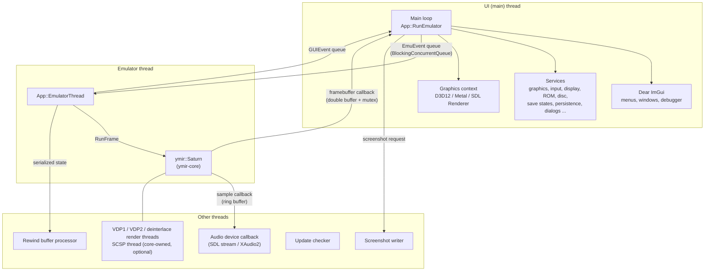
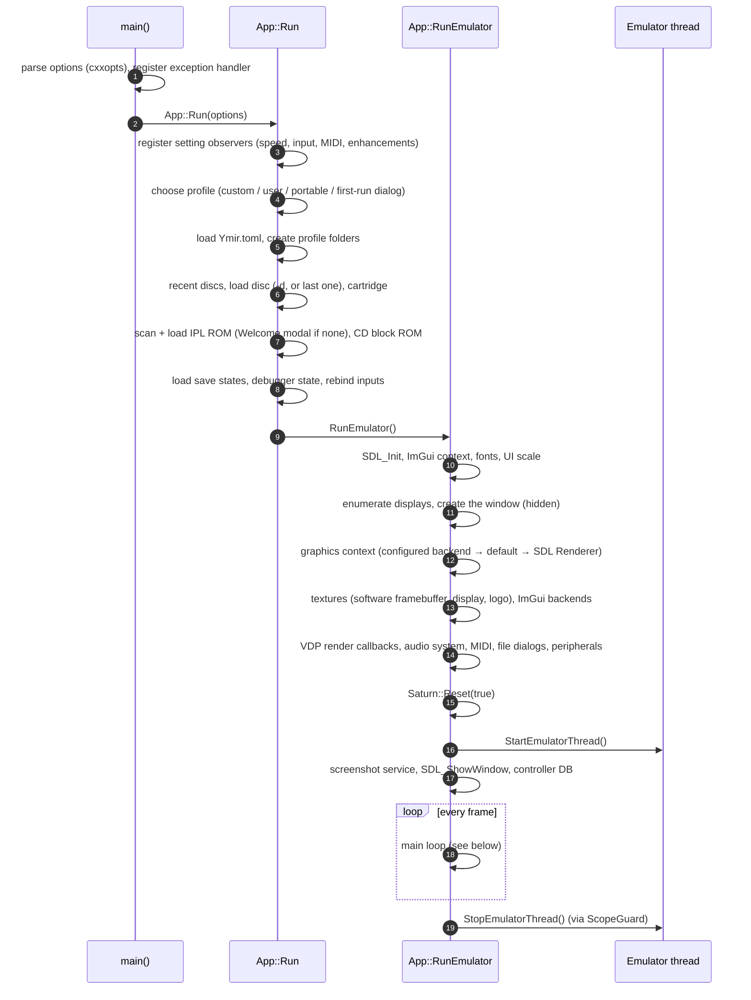
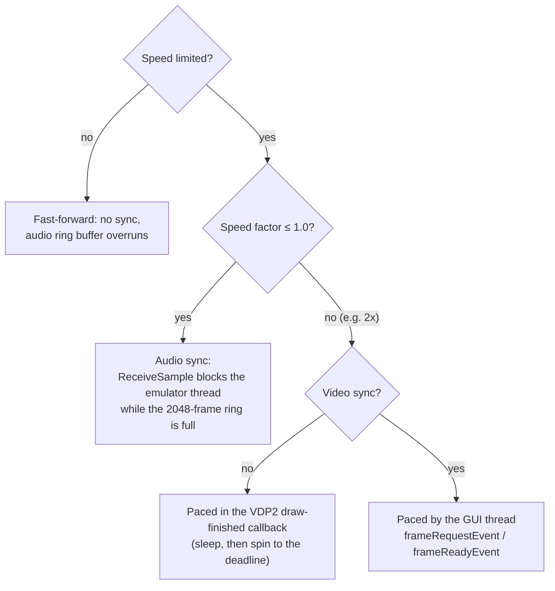
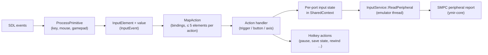
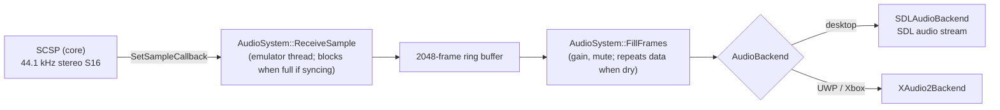
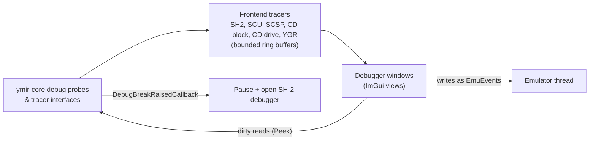

# The SDL3 frontend (`apps/ymir-sdl3`)

> Part of the [Ymir documentation](README.md). Paths are relative to `apps/ymir-sdl3/src/` unless written out.

`ymir-sdl3` is the program users run. It wraps the emulation core (`ymir::Saturn`) in a window, feeds it input,
plays its audio, shows its video and offers settings, save states, rewind and a debugger, built with
[SDL3](https://libsdl.org) and [Dear ImGui](https://github.com/ocornut/imgui).

`app/app.cpp` opens with a long design comment that sums up the model:

> This frontend runs the emulator core in a dedicated thread while the GUI runs on the main thread. Synchronization
> between threads is accomplished by using a blocking concurrent queue to send events to the emulator thread, which
> processes the events between frames. The debugger performs dirty reads and enqueues writes to be executed in the
> emulator thread. Video and audio callbacks use minimal synchronization.

## Big picture



## Startup



Notes:

- **Entry points.** On Windows, `winmain.cpp` converts the command line and calls `main`. On UWP the WinRT entry
  point of SDL3-uwp calls `main` (see [docs/uwp](../uwp/README.md)).
- **Command line** (`main.cpp`):

  | Option | Meaning |
  |---|---|
  | `-d`/`--disc` | Disc image (also positional) |
  | `-p` | Custom profile directory |
  | `-u` | Force the user profile |
  | `-f` | Start in full screen |
  | `-P` | Start paused |
  | `-F` | Start in fast-forward |
  | `-D` | Start with debug tracing |
  | `-E` | Capture all exceptions |

- **Profile selection order** (`App::Run`): a profile forced with `-p`, then the user profile forced with `-u`, then
  a portable profile in the current directory, then one in the executable directory, then the user profile. If none
  of them contains `Ymir.toml`, a first-run dialog asks for *installed* or *portable* mode. Flatpak always uses the
  user profile. UWP uses `<drive>:\Ymir` if present, otherwise LocalState.
- **Ordering constraints** are documented in the code:
  - Recent discs are loaded before the disc, "because it saves the recent list".
  - The IPL ROM is loaded after the disc, "so that the auto-detected region is used to select the appropriate ROM".
- **Graphics backend fallback:** the configured backend, then `kDefaultBackend`, then the SDL Renderer. If all three
  fail, a startup error lists every failure.
- **Two-texture scaling** (comment in `RunEmulator`):
  - "The framebuffer texture containing the Saturn framebuffer, updated on every frame";
  - "The display texture, rendered to the screen";
  - "rendering the framebuffer texture into the display texture using nearest interpolation with an integer scale,
    then rendering the display texture onto the screen with linear interpolation" keeps pixels sharp at any scale.
- **Shutdown** is entirely `ScopeGuard`-driven. The guards run in reverse order:
  1. screenshot thread;
  2. emulator thread;
  3. audio;
  4. null VDP renderer;
  5. window (persists the geometry and debugger state);
  6. ImGui ini;
  7. `SDL_Quit`;
  8. Discord;
  9. update checker;
  10. settings save.

## The main loop

Each iteration of `while (true)` in `App::RunEmulator`:

1. **Frame pacing.**
   - At 100 % speed the GUI frame interval is adjusted to keep the audio ring buffer between 30 % and 70 % full.
   - With video sync the loop sleeps until 1 ms before the deadline, then spins.
   - `dupGUIFrames` repeats GUI frames at low emulation speeds, so the UI stays responsive.
2. **SDL events.**
   - ImGui gets every event first.
   - Keyboard, mouse and gamepad events go to `inputContext.ProcessPrimitive` unless ImGui wants them.
   - Window events cover resize, move, focus, display changes and file drops (a dropped file loads a disc).
   - `SDL_EVENT_QUIT` leaves the loop.
3. **Input axes, then wake the emulator** (`m_emuProcessEvent.Set()`).
4. **GUI event queue.** Requests from the emulator thread, workers and UI code: dialogs, backend switches,
   screenshots, ROM reloads, notifications.
5. **Display update.** With video sync, wait for the emulator's frame. If a new frame is ready, flip the double
   buffer and upload it to the framebuffer texture.
6. **Title bar and performance counters**, input update and mouse-cursor auto-hide.
7. **ImGui frame:**
   - the main menu bar (it auto-hides in full screen);
   - the dock space and the optional windowed video output;
   - every window and modal;
   - OSDs: rewind bar, speed, volume, FPS, messages.
8. **Render:**
   - clear the screen;
   - scale and draw the Saturn display (integer scaling, forced aspect, rotation, auto-fit);
   - draw ImGui;
   - `Present()`. If presenting fails, the graphics settings are reset and the app exits with a fatal error.
9. **Housekeeping:** `imgui.ini`, settings auto-save, debugger state, pending persistence, Discord.

## Threads and synchronization

| Thread | Owner | Role |
|---|---|---|
| Main / UI | `main` | Events, ImGui, rendering, presenting, settings and persistence |
| Emulator | `App::StartEmulatorThread` | Drains the emulator event queue, runs frames, handles rewind |
| Screenshot processing | `ScreenshotService` | Rotates, scales and writes PNGs |
| Update checker | `UpdateCheckerService` | Checks the stable and nightly channels |
| Rewind buffer processor | `RewindBuffer` | Serializes, XOR-deltas and LZ4-compresses states |
| MIDI init (detached) | `MIDIService` | "Initialize in a thread because it can take a *long* time to load on some systems" |
| VDP1, VDP2, deinterlace render threads; SCSP thread | ymir-core | Optional, controlled by settings (`threadedVDP1/2/Deinterlacer`, `threadedSCSP`) |
| Audio callback | SDL / XAudio2 | Pulls samples from the ring buffer |

### The emulator thread

`App::EmulatorThread` loops over two phases:

- **Drain events.** While paused, `wait_dequeue_bulk` blocks until something arrives; otherwise `try_dequeue_bulk`
  takes up to 64 events.
- **Run the step action**: `RunFrame`, `FrameStep`, `StepMSH2`, `StepSSH2` or `Noop`. With video sync and a speed
  limit it first waits for the UI's `m_emuProcessEvent`. When the rewind buffer is enabled, each frame's state is
  saved into it; while rewinding, a state is popped and loaded before the frame.

### Pacing modes



- `EmuSpeed::ShouldSyncToAudio()` returns true when "the speed is limited to 1.0 or less".
- The video framebuffer is double-buffered (`Screen::framebuffers`, `currBackFramebuffer`, `mtxFramebuffer`): "emu
  renders to one, GUI displays the other". `frameReadyEvent` means the emulator wrote a frame; `frameRequestEvent`
  means the GUI is ready for the next one.
- `SharedContext::Locks` (cart, disc, peripherals, ROM manager, backup RAM, messages, breakpoints, watchpoints,
  updates…): "These locks must be held by the emulator thread whenever the object instances are to be replaced or
  modified. The GUI must hold these locks when accessing these objects".
- `util::Event` (ymir-core) is the manual-reset event used everywhere. It is atomics-based on Windows, Linux and
  FreeBSD, and uses a condition variable elsewhere.

## `SharedContext`

`app/shared_context.hpp` is the state shared by the UI thread, the emulator thread and the services:

| Group | Contents |
|---|---|
| Emulator | `saturn.instance` (`std::unique_ptr<ymir::Saturn>`) plus accessors for every component |
| Audio and display | `audioSystem`, `display` (SDL displays), `screen` (window, resolution and scale, framebuffers, video sync, counters) |
| Speed | `emuSpeed`, `paused` |
| Input | `inputContext` plus the per-port input state for every peripheral type |
| Profile and ROMs | `profile`, `romManager`, the IPL/CD block ROM paths, update info |
| History | `rewindBuffer` and `rewinding`; `state` (loaded disc, recent discs) |
| Concurrency | `locks`, `eventQueues` (`emulator`, `gui`) |
| Debugging | `tracers` (SH-2 ×2, SCU, SCSP, CD block, CD drive, YGR), `messages` (10 000-entry log), `debuggers` |
| Services | `serviceLocator`: a type-indexed registry of the services |

### Events: how the UI talks to the emulator

```mermaid
sequenceDiagram
    participant UI as UI code (menu, widget, hotkey)
    participant Q1 as eventQueues.emulator
    participant EMU as Emulator thread
    participant Q2 as eventQueues.gui
    participant LOOP as Main loop
    UI->>Q1: EnqueueEvent(events::emu::SoftReset())
    Note over EMU: between frames
    Q1->>EMU: dequeue → Saturn::Reset(false)
    EMU->>Q2: EnqueueEvent(events::gui::StateSaved(slot))
    Q2->>LOOP: dequeue → persist the save state
```

- **`EmuEvent`** (`events/emu_event.hpp`) has these types: resets, pause, frame/CPU stepping, tray, disc, cartridge,
  backup memory, MIDI input, thread priority, shutdown and **`RunFunction`**. `RunFunction` carries a
  `std::function<void(SharedContext&)>`. Most "specialized" factories in `events/emu_event_factory.cpp` are
  `RunFunction` lambdas:
  - clock speed, video standard, area code;
  - VDP renderer switch (D3D12 hardware renderer, or software fallback);
  - debug tracing;
  - memory dumps;
  - peripherals, cartridges, backup memory;
  - SH-2 cache and clock factor, CD block LLE;
  - threading options;
  - save/load/undo state.

  Debugger writes have their own factories in `emu_debug_event_factory.hpp`.
- **`GUIEvent`** (`events/gui_event.hpp`) covers:
  - file and folder dialogs, the backup memory manager, the settings tabs and the debugger windows;
  - graphics backend switches, full screen, input rebinding;
  - ROM (re)loads, update checks, screenshots;
  - notifications such as `StateLoaded` and `StateSaved`.

## Services

All services are constructed by `App` and registered in `SharedContext::serviceLocator`.

| Service | Responsibility |
|---|---|
| `GraphicsService` | Owns the `gfx::IGraphicsContext`. Creates it per backend with fallback and switches backends at runtime. Owns GUI texture handles, which are recreated automatically after a backend switch. Wraps clear, ImGui, render-to-texture, rotated draw and present. Wires the hardware VDP renderer's callbacks |
| `DisplayService` | UI scale, styles, fonts, full screen (exclusive/borderless), window geometry persistence |
| `InputService` | Registers every action handler (hotkeys and peripherals), rebinds inputs, draws gun crosshairs, builds the SMPC peripheral reports (`ReadPeripheral<port>`) |
| `MouseCaptureService` | Captures the system cursor or physical mice for the Virtua Gun and Shuttle Mouse |
| `SaveStateService` | 10 slots, each with an undo backup; files in `savestates/<discHash>/`; debugger breakpoints and watchpoints per disc |
| `PersistenceService` | Debounced (250 ms) save of SMPC persistent data (SMEM, RTC) |
| `ROMService` | Scans and loads IPL and CD block ROMs and ROM cartridges; region-aware IPL selection; SDL game controller DB |
| `DiscService` | Loads disc images (optional preload to RAM), region autodetection, per-game backup RAM, recent discs, recommended cartridge auto-load |
| `FileDialogService` | SDL file dialogs (WinRT pickers on UWP); switches exclusive full screen to borderless while a dialog is open |
| `MIDIService` | RtMidi input/output, normal or virtual ports |
| `DiscordRPCService` | Rich presence |
| `UpdateCheckerService` | Background update checks with a cache |
| `ScreenshotService` | Background PNG writer |
| `WindowManagerService` | Owns every window, the debugger window sets, the generic/error/welcome modals and 8 memory viewers |

### Graphics contexts

`gfx::IGraphicsContext` (`services/gfx/gfx_context.hpp`) provides:

- initialize/shutdown and framebuffer resize;
- textures (create, update, resize, delete), render-to-texture, rotated draw;
- the ImGui hooks;
- the hardware VDP display output (acquire, release, download);
- present modes and `Present()`.

| Backend | Status |
|---|---|
| Direct3D 12 (Windows, UWP) | Complete; the only backend with **hardware-accelerated VDP rendering** |
| Metal (macOS) | Complete GUI context |
| SDL Renderer (all) | "Provided as fallback in case none of the platform graphics APIs are supported" |
| Direct3D 11, Vulkan | Stubs, hidden unless `Ymir_FF_ENABLE_UNIMPL_GFX_BACKENDS` |
| Null | Accepts everything, does nothing |

The default backend is D3D12, else Metal, else Vulkan, else the SDL Renderer. Present modes are VSync, Mailbox,
Adaptive and NoSync.

## Input



- **Primitives** (`input/input_primitives.hpp`): keyboard keys (USB HID codes), combos with modifiers, mouse
  buttons and axes, gamepad buttons and 1D/2D axes.
- **Actions** (`input/input_action.hpp`, catalog in `app/actions.hpp`) have a kind: trigger, combo trigger,
  repeatable trigger, button, or one of several absolute/relative 1D/2D axis kinds. They are grouped into general,
  view, audio, CD drive, save states, system, emulation, debugger, and one group per peripheral (Control Pad, 3D
  Control Pad, Arcade Racer, Mission Stick, Virtua Gun, Shuttle Mouse).
- **`InputContext`**: "processing input primitives … which translate them into input events. These are mapped to
  actions … Finally, the corresponding action handlers … are invoked."
  - Deadzones default to 0.15 and the analog-to-digital sensitivity to 0.2.
  - Capture mode drives the rebinding widgets.
  - The context pointer of a binding points to the per-port input struct.
- `InputService::ReadPeripheral` runs on the emulator thread when the SMPC polls the ports. The code calls it "the
  appropriate location to capture inputs for a movie recording".

## Settings, profile and persistence

- **Settings** (`app/settings.hpp`) live in `Ymir.toml`, read and written with toml++. `kConfigVersion` is 6, and
  older layouts are migrated "on a best-effort basis".
  - Sections: General, GUI, System, Hotkeys, Input (per port), Video, Audio, Cartridge, CD Block.
  - Values are `util::Observable<T>` (ymir-core): "Observer functions run immediately after they're added … and on
    the act of changing the value". Observers forward changes to the core, mostly as emulator events.
  - Auto-save happens 250 ms after the last change (`MakeDirty` / `CheckDirty`).
  - `Settings::BindConfiguration` mirrors the relevant settings into `ymir::core::Configuration`.
- **Profile** (`app/profile.hpp`):

  | Folder | Contents |
  |---|---|
  | `roms/ipl/` | BIOS images |
  | `roms/cdb/` | CD block ROMs (for LLE) |
  | `roms/cart/` | ROM cartridges |
  | `backup/` | Backup RAM images; `exported/` holds exports |
  | `state/` | `imgui.ini`, `window.txt`, `recent_discs.txt`, `smpc-<region>.bin`, `bup-int.bin`, `updates/`, `debugger/` |
  | `savestates/` | Save states per disc hash |
  | `dumps/` | Memory dumps |
  | `screenshots/` | Screenshots |

- **Rewind** (`app/rewind_buffer.*`):
  - A ring of 3600 frames (one minute at 60 fps).
  - Each state is serialized, XORed with the previous one and LZ4-compressed on a dedicated thread.
  - Hard resets, disc changes and CD block LLE changes reset it.
- **ROM manager** (`app/rom_manager.*`): recursive scans matched against the core's IPL, CD block ROM and ROM
  cartridge databases by XXH128 hash.

## Audio



`AudioBackend` (`app/audio_backend.hpp`) is pull-based and "Decouples AudioSystem (which owns the ring buffer, gain,
mute and the sync/silent policy, all platform independent) from the API that actually plays sound". `FillFrames`
"Always returns exactly `frameCount` frames, repeating whatever is available when the buffer has run dry". The code
calls this a crude form of audio stretching.

## UI

- **Main menu:**

  | Menu | Contents |
  |---|---|
  | File | Discs, recent discs, host drives, tray, save states with undo, screenshots, profile folders |
  | View | Scaling, aspect, rotation, full screen, window fitting, windowed video output |
  | System | System state, disc hash, backup memory manager, resets, video standard, region, cartridges |
  | Emulation | Pause, frame step forward/back, rewind |
  | Settings | 11 tabs: General, GUI, Hotkeys, System, IPL, Input, Video, Audio, Cartridge, CD Block, Tweaks |
  | Debug | See below |
  | Help | Welcome, updates, message history, ImGui demo, About |

- **Windows** (`ui/windows/`):
  - System state, backup memory manager, settings, peripheral configuration, message history, About, update
    onboarding and update windows.
  - The Welcome modal (shown when no BIOS is found) and the generic/error modals live in `WindowManagerService`.
- **Building blocks:**
  - `WindowBase` has an `Open` flag, `PrepareWindow`/`DrawContents`, and closes on gamepad B.
  - Views (`ui/views/**`) are reusable panels that windows are composed from.
  - Widgets (`ui/widgets/`) include an input capture popup, crosshairs, an oscilloscope, a rewind bar, and selectors
    for peripherals, video standard and region.
- **Fonts** (embedded with CMakeRC):
  - Spline Sans and Spline Sans Mono, merged with M PLUS U for Japanese glyphs and Material Symbols for icons;
  - Zen Dots as the display font;
  - sizes from 14 to 64 px, scaled by the UI scale.

## Debugger



Window sets per component (`ui/windows/debug/*_window_set.hpp`):

| Component | Windows |
|---|---|
| SH-2 (master and slave) | Debugger (disassembly, registers, data and call stacks, stepping), breakpoints, watchpoints, interrupts and their trace, exception vectors, cache, DIVU, timers (FRT/WDT), power, DMAC and its trace |
| SCU | Registers, DMA and its trace, interrupt trace, DSP (disassembly, registers, data RAM, DMA, trace) |
| SCSP | Output (oscilloscope), slots, KYONEX trace |
| VDP | VDP1 registers; VDP2 registers, layer visibility, BG/sprite layer parameters, color calculation, windows, debug overlay, VRAM access patterns, CRAM (editable) |
| CD block | HLE command trace, filters, partitions; LLE drive state trace, YGR command trace |
| Other | 8 memory viewers (read with `Peek`, write via events with or without side effects), debug output (SCU debug port), full memory dumps |

Breakpoints and watchpoints are persisted per disc hash. Tracing must be enabled (menu, hotkey or `-D`) for them to
work. When the core raises a break, the frontend pauses and opens the SH-2 debugger at the PC.

## Notes found while documenting

- `MIDIService::GetMidiOutputPortName()` appears to return the virtual *input* port name for virtual outputs.
- The `LoadDisc` and `OpenHostDevice` emulator events open error modals from the emulator thread.
- The file header comment about the audio buffer size predates the current 512-sample request plus 2048-frame ring.
- Video sync is still applied with hardware renderers. The guard is commented out with a TODO in the main loop.
