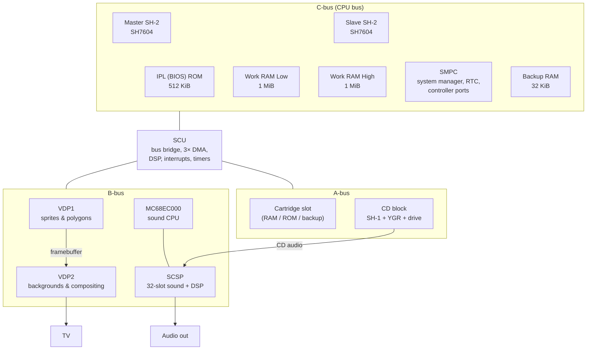
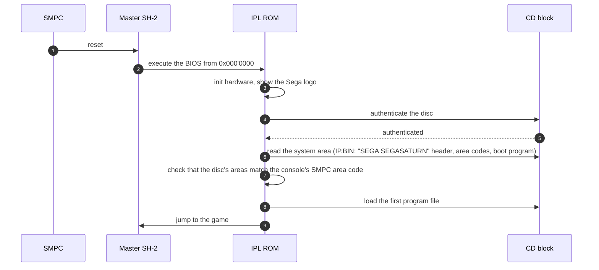

# The Sega Saturn, chip by chip

> Part of the [Ymir documentation](README.md). This page explains the hardware Ymir emulates and points to the code
> that emulates each part. Clock and memory figures come from Ymir's own definitions
> (`libs/ymir-core/include/ymir/sys/clocks.hpp`, the memory maps in the source) unless stated otherwise.

The Saturn (1994) is famous for being hard to program and hard to emulate. Instead of one fast CPU and one graphics
chip, it has **two main CPUs, two video processors, a sound processor with its own CPU, a DSP coprocessor and a CD
subsystem that is a computer in its own right**. All of them run concurrently and share buses. Many games depend on
the exact timing between them, which is why emulator accuracy matters so much on this machine.

## Block diagram

## Clocks

| Part | Clock | Ymir source |
|---|---|---|
| Both SH-2s, VDP1, VDP2, SCU | ≈ 26.85 MHz (320-pixel modes) or ≈ 28.64 MHz (352-pixel modes), NTSC; slightly lower on PAL | `sys/clocks.hpp` |
| SCU DSP | Half the master clock | `hw/scu/scu_dsp.*` |
| SCSP | 22.5792 MHz (512 × 44.1 kHz) | `hw/scsp/` |
| MC68EC000 | Half the SCSP clock (≈ 11.3 MHz) | `hw/m68k/` |
| CD block SH-1 | 20 MHz | `hw/sh1/` |
| SMPC | 4 MHz | `hw/smpc/` |

The master clock changes with the horizontal resolution. Games switch between the two modes with an SMPC command, and
the system soft-resets when they do.

## CPUs: two SH-2s

The **Hitachi SH7604** is a 32-bit RISC CPU (SuperH-2) with 16-bit instructions, a 5-stage pipeline, delay-slot
branches and a 4 KiB 4-way cache. Each has on-chip peripherals:

| Peripheral | Purpose |
|---|---|
| DMAC | 2-channel DMA controller |
| DIVU | Division unit (32/32 and 64/32) |
| FRT | Free-running timer, with input capture |
| WDT | Watchdog / interval timer |
| SCI | Serial interface |
| BSC | Bus state controller |
| INTC | Interrupt controller |
| UBC | User break controller |

- The **master** SH-2 runs the game and receives most interrupts.
- The **slave** is switched on by the game (SMPC SSHON) and used for extra computation, typically 3D math. The two
  CPUs signal each other by writing to the MINIT/SINIT addresses, which triggers the *other* CPU's FRT input capture.

**In Ymir:**

- `hw/sh2/` is a cycle-counting interpreter with an optional cache model.
- `Saturn::Run` runs both CPUs interleaved in 32-cycle slices.
- See [core-system.md](core-system.md#sh-2-cpus-hitachi-sh7604).

## SCU: the System Control Unit

The SCU connects the CPU bus to the **A-bus** (cartridge and CD block) and the **B-bus** (video and sound). It also
provides:

- **3 DMA channels** with many trigger sources (VBlank, HBlank, timers, sound, end of sprite drawing). They are the
  main way to move data to VRAM and sound RAM.
- **An interrupt controller** that funnels VDP, SMPC, SCSP, DMA, DSP, timer and external (A-bus) interrupts to the
  master SH-2.
- **Two timers**, synchronized to the video lines.
- **The SCU DSP**, a fixed-point coprocessor with a 256-instruction program RAM. It is used mostly for 3D
  transformations.

**In Ymir:** `hw/scu/`. DMA timing is the hardest part. See [core-system.md](core-system.md#scu-system-control-unit).

## Memory map (SH-2 view)

| Address | What |
|---|---|
| `0x000'0000` | IPL (BIOS) ROM, 512 KiB |
| `0x010'0000` | SMPC registers |
| `0x018'0000` | Backup RAM, 32 KiB |
| `0x020'0000` | Work RAM Low, 1 MiB (slower DRAM) |
| `0x100'0000` | MINIT / SINIT (inter-CPU signalling) |
| `0x200'0000` | A-bus: cartridge |
| `0x580'0000` | A-bus: CD block |
| `0x5A0'0000` | B-bus: SCSP sound RAM (512 KiB) and registers |
| `0x5C0'0000` | B-bus: VDP1 VRAM, framebuffer and registers |
| `0x5E0'0000` | B-bus: VDP2 VRAM, CRAM and registers |
| `0x5FE'0000` | SCU registers |
| `0x600'0000` | Work RAM High, 1 MiB (fast SDRAM) |

Higher address bits select the SH-2's cache behaviour: cached, cache-through, cache purge, cache address and data
arrays, and on-chip registers. The full map as Ymir implements it is in
[core-system.md](core-system.md#buses-and-the-memory-map).

## Video: VDP1 and VDP2

| | VDP1 | VDP2 |
|---|---|---|
| Role | Draws **sprites and polygons** into a framebuffer | Generates **backgrounds** and **composes** the final picture |
| Memory | 512 KiB VRAM (command lists, textures), 2 × 256 KiB framebuffers | 512 KiB VRAM in 4 banks, 4 KiB color RAM |
| Primitives | Normal, scaled and distorted sprites (textured quads), polygons, polylines, lines | NBG0–NBG3 (tile maps or bitmaps with scrolling, zoom, line scroll), RBG0–RBG1 (rotation and scaling with per-pixel coefficients, e.g. 3D floors), the sprite layer |
| Effects | Gouraud shading, half-transparency, shadow, half-luminance, mesh (checkerboard transparency), clipping | Priorities, color calculation (blending), shadows, windows, line color and back screens, color offset, mosaic, gradation |
| Output | — | 320 / 352 / 640 / 704 pixels wide; 224 / 240 / 256 lines, doubled in interlaced modes |

- **Quads instead of triangles.** VDP1 draws everything as *quads*, by rasterizing lines between two edges. That is
  why Saturn 3D looks the way it does, and why polygon transparency is so often faked with **meshes**. Ymir's
  *transparent meshes* enhancement replaces those meshes with real half-transparency.
- **VRAM access slots.** VDP2 has to fetch background data within fixed VRAM access slots that the game programs (the
  CYCxx registers). Bad settings produce glitches on real hardware, and some games rely on this.

**In Ymir:**

- `hw/vdp/` holds the controller and its timing.
- `hw/vdp/renderer/` holds the software renderer (CPU, optionally threaded) and the Direct3D 12 compute renderer.
- See [video.md](video.md).

## Audio: SCSP and MC68EC000

- **The SCSP** (Yamaha YMF292) is a 32-voice synthesizer. Each voice ("slot") plays PCM samples from sound RAM or
  does FM synthesis by modulating other slots, with its own envelope and LFOs.
- **A 128-step DSP** adds effects such as reverb and echo.
- **Other parts:** three timers, a MIDI port, a DMA engine and 512 KiB of sound RAM.
- **The MC68EC000** runs the sound driver; games rarely touch the SCSP directly.
- **CD audio** from the CD block is mixed in through the DSP.

**In Ymir:** `hw/scsp/` and `hw/m68k/`; see [audio.md](audio.md).

## CD subsystem

The CD block is a separate computer:

- a **Hitachi SH-1** (20 MHz) running its own ROM, with 512 KiB of buffer RAM;
- the **YGR** gate array, which exposes command registers and a data FIFO to the main system;
- a **2× CD-ROM drive**.

Games send high-level commands (play, seek, read sectors, set filters, read files), and the CD block delivers
sectors into buffers organized by **filters** and **partitions**. It also streams CD audio to the SCSP. An optional
**MPEG card** (Video CD) plugs into it.

**In Ymir:** HLE (`hw/cdblock/cdblock.*`) or LLE (`hw/sh1/`, `hw/cdblock/ygr.*`, `hw/cdblock/cd_drive.*`) with a real CD
block ROM. Disc images come from `media/`. See [cd-and-media.md](cd-and-media.md).

## SMPC: System Manager and Peripheral Control

The SMPC is a small 4-bit microcontroller that handles:

- **power and reset:** the slave SH-2 and the 68000 on/off, system reset, NMI, reset button;
- **the dot clock change** between 320 and 352 modes;
- **the real-time clock and the SMPC memory** (battery-backed);
- **the controller ports** (INTBACK): it reads the pads, wheels, sticks, guns and mice;
- **the area code**, which tells the BIOS the console's region.

**In Ymir:** `hw/smpc/`, including the peripheral models in `hw/smpc/peripheral/`. See
[core-system.md](core-system.md#smpc-system-manager-and-peripheral-control).

## Cartridge slot

The cartridge slot sits on the A-bus. Cartridges add:

| Cartridge | Used for |
|---|---|
| Backup RAM (4–32 Mbit) | More save space |
| 1 MB DRAM (8 Mbit) | Some SNK and Capcom games |
| 4 MB DRAM (32 Mbit) | Capcom games such as X-Men vs. Street Fighter |
| ROM (2 MB) | King of Fighters '95, Ultraman |

Ymir's game database knows which games need which cartridge. See [core-system.md](core-system.md#cartridges).

## Regions and the boot sequence

- **Area codes:**

  | Code | Region |
  |---|---|
  | J | Japan |
  | T | Asia NTSC |
  | U | North America |
  | B | Central/South America NTSC |
  | K | Korea |
  | A | Asia PAL |
  | E | Europe |
  | L | Central/South America PAL |

  Ymir can **autodetect** the region from the disc header and set the SMPC area code and the video standard (NTSC or
  PAL) to match, before the BIOS checks it.
- **Without a BIOS image** Ymir cannot boot games. The frontend shows a *Welcome* screen that asks for one. A tiny
  built-in placeholder program keeps the CPU idle in the meantime.
- **Disc authentication** is always reported as successful by the HLE CD block.

## Why the Saturn is hard to emulate

- **Two CPUs and many co-processors share buses.** The emulator must interleave them finely and model bus stalls,
  most visibly in SCU DMA.
- **Timing-sensitive games.** Many games break if a component runs too fast or too slow. Ymir keeps tunable bus
  timings, per-game flags and documented hacks for these; see `docs/dev-notes/finicky-games/`.
- **The VDP2 has a very large feature set.** It combines priority, color calculation and windowing with mid-frame
  register changes.
- **Quads, meshes and interlacing** need enhancements (deinterlacing, transparent meshes) to look good on modern
  displays.
- **The CD block** is a computer of its own, which is why Ymir offers both HLE and LLE.

The notes in `docs/dev-notes/` record real hardware and game behaviours discovered during development:

| Folder or file | Contents |
|---|---|
| `system-info/` | Memory maps, interrupts, VDP timings |
| `finicky-games/` | Games that stress specific behaviours |
| `game-bugs.txt` | Bugs that exist on real hardware |
