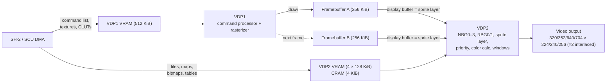
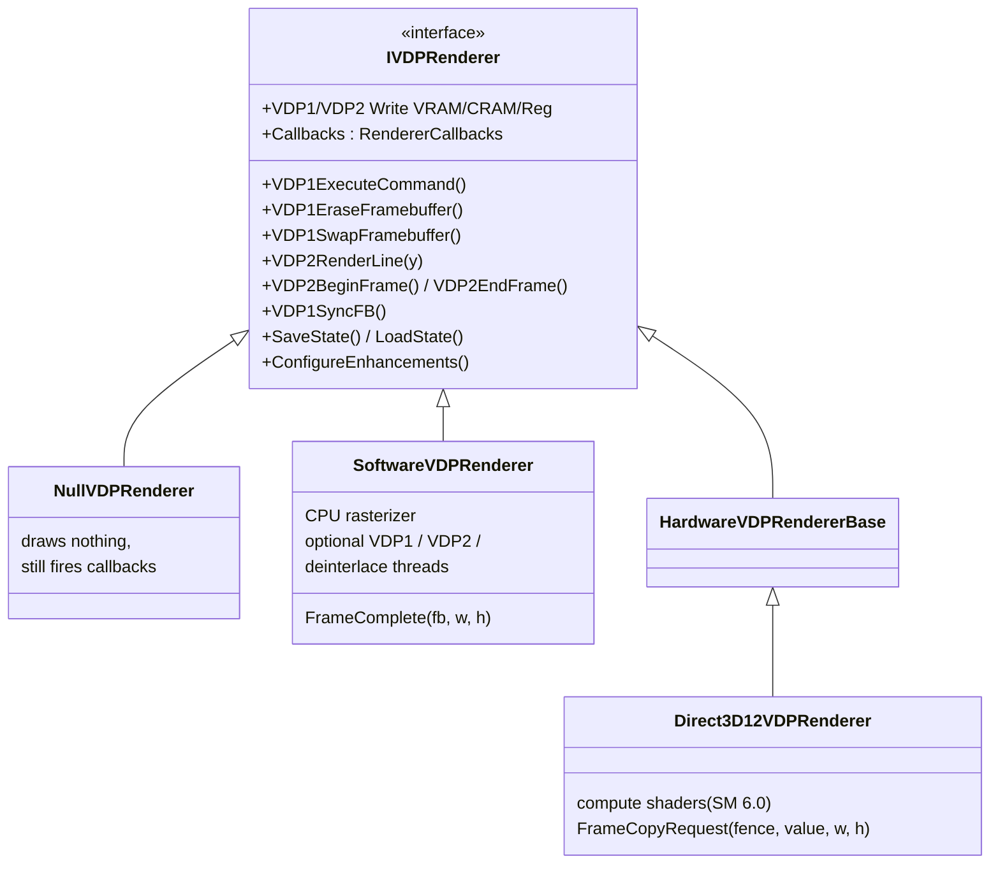
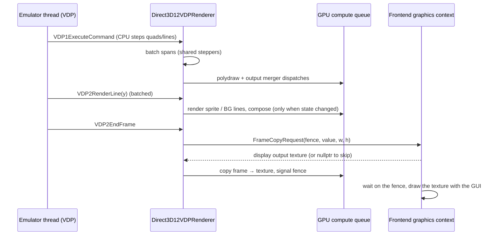
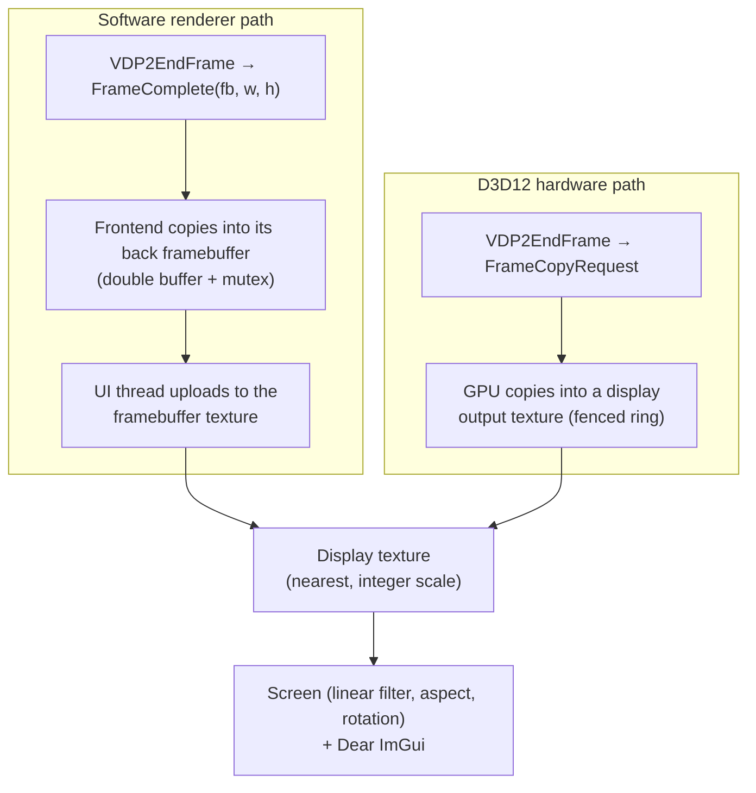

# Video: VDP1, VDP2 and the renderers

> Part of the [Ymir documentation](README.md). For what the hardware does, see
> [saturn-hardware.md](saturn-hardware.md#video-vdp1-and-vdp2). Paths are relative to `libs/ymir-core/` unless written
> out.

## The two video chips

The Saturn draws a picture with two cooperating chips:

- **VDP1** is the sprite and polygon processor. It walks a **command list** in its 512 KiB VRAM and draws sprites
  (normal, scaled, distorted), polygons, polylines and lines into one of **two 256 KiB framebuffers**. The buffers
  alternate: VDP1 draws into one while VDP2 displays the other.
- **VDP2** is the background and compositing processor. It produces up to **four scrolling backgrounds** (NBG0–NBG3)
  and **two rotating backgrounds** (RBG0/RBG1) from its 512 KiB VRAM and 4 KiB color RAM (CRAM). It reads VDP1's
  display framebuffer as the **sprite layer**, then composes everything, line by line:
  - priorities;
  - color calculation (blending), shadows and windows;
  - line color and back screens, color offsets and mosaic.

## `vdp::VDP`: the controller

`include/ymir/hw/vdp/vdp.hpp` and `src/ymir/hw/vdp/vdp.cpp`. One object holds both chips. Their memory and registers
are in `VDPState` (`vdp_state.hpp`).

### Timing

- A single scheduler event (`VDPPhase`) steps the horizontal phases: active, right border, sync, left border.
  `IncrementVCounter` steps the vertical phases: active, bottom border, blanking & sync, V-counter skip, top border,
  last line.
- `UpdateResolution` builds the timing tables:
  - horizontal resolution 320/352/640/704;
  - vertical resolution 224/240/256, doubled when interlaced;
  - scaled by the dot clock and the SH-2 clock factor.

  The tables are "Based on https://github.com/srg320/Saturn_hw/blob/main/VDP2/VDP2.xlsx".
- What happens at each phase:

  | Point in the frame | What happens |
  |---|---|
  | Start of each active line | VDP2 renders the line |
  | Right border | HBlank IN |
  | Bottom border | VBlank IN |
  | Blanking & sync | VDP2 end of frame; the display-period erase |
  | Top border | TVMD latch |
  | Last line | VBlank OUT, VDP2 begin frame, then the VDP1 framebuffer erase/swap decision (the automatic "1-cycle erase+swap" when FCM = 0, otherwise manual via FCT) |

### VDP1 command processing

- **Cycle budget.** Commands run inside `VDP::Advance(cycles)`, which the system run loop calls after the CPUs. The
  budget is generous on purpose: "HACK: give VDP1 way more cycles than needed to compensate for some optimizations
  not accounted for in VDP cost estimations". Each command costs 16 cycles to fetch, plus a rough per-pixel estimate
  (`VDP1CalcCommandTiming`, "HACK: rough cost estimates").
- **Command types** (`vdp1_defs.hpp`):

  | Code | Command |
  |---|---|
  | 0x0 | Normal sprite |
  | 0x1 | Scaled sprite |
  | 0x2 / 0x3 | Distorted sprite |
  | 0x4 | Polygon |
  | 0x5 / 0x7 | Polyline |
  | 0x6 | Line |
  | 0x8 / 0xB | User clipping |
  | 0x9 | System clipping |
  | 0xA | Local coordinates |

- **Jump modes** are next, assign, call and return. Infinite command loops are detected (32 iterations or
  self-jumps), with comments naming Akumajou Dracula X, Gale Racer, Rayman, Sonic R and Stellar Assault SS. They are
  suspended until the CPU writes VRAM.
- **Plot trigger and end:** writing PTMR starts a frame. Some games need an artificial delay when it is written
  outside the active period (Fighter's History Dynamite, Cyberbots, Earthworm Jim 2). The end of a draw raises the
  SCU *sprite draw end* interrupt.
- **Double buffering:** an `FBRAMIndex` holds the *display* and *draw* buffer indices. The swap is ordered
  carefully: "this flip needs to happen *after* the renderer processes the framebuffer swap … renderers … may use
  multithreading".

### VDP2 VRAM access patterns

- `VDP2State::CalcAccessPatterns` derives the background fetch delays from the CYCxx registers, which divide each
  VRAM bank's access slots between backgrounds and the CPU. It is "an approximation of the real thing, since this VDP
  emulator does not actually perform the accesses described by the CYCxn registers".
- A per-game relaxation ("allow bitmap data access during SH-2 cycles") fixes flickering FMVs in Shin Kaitei Gunkan,
  Lunar SSS and Dark Savior.

### Per-game knobs

These are applied from the game database, see [core-system.md](core-system.md#game-and-rom-databases-db):

- stall VDP1 on VRAM writes;
- slow VDP1;
- skip empty VDP1 tables;
- relaxed VDP2 bitmap access;
- Virtua Gun jitter. Its comment: "Death Crimson is the only known game that detects perfectly stable shots as
  reloads".

## The renderer abstraction

The VDP decides *when* things happen. A renderer decides *how* pixels are produced.

- `IVDPRenderer` (`include/ymir/hw/vdp/renderer/vdp_renderer_base.hpp`) receives every memory and register write,
  plus the frame and line events above.
- **Common callbacks** (`RendererCallbacks`): `VDP1DrawFinished`, `VDP1FramebufferSwap`, `VDP2DrawFinished`.
- **Renderer-specific callbacks:**
  - the software renderer's `FrameComplete(fb, width, height)` delivers "little-endian XRGB8888" pixels;
  - the D3D12 renderer's `FrameCopyRequest(fence, value, width, height)` asks the frontend for a texture to copy the
    frame into.
- `VDP::UseRenderer<T>` copies all callbacks onto the new renderer, "as it allows the frontend to configure these
  callbacks only once to be reused across all renderers".
- **Renderer types:**
  - `Null`;
  - `Software`;
  - `Direct3D12`, Windows only. There is no Vulkan or Metal VDP renderer in the core yet.
- **Enhancements:**
  - `deinterlace`: renders interlaced high-resolution modes progressively. When it is off, "high resolution
    interlaced modes are rendered using the weave method".
  - `transparentMeshes`: "VDP1 sprites drawn in mesh mode are instead rendered to a separate sprite buffer that is
    blended with half-transparency on top of other graphics".

### Software renderer

`vdp_renderer_sw.{hpp,cpp}`, about 5,600 lines.

- **Threads.** "VDP1 render thread", "VDP2 render thread" and "VDP deinterlace render thread" are each optional, and
  all are on by default. Each thread has its own copy of memory and registers and a `BlockingConcurrentQueue` of
  events. Writes are batched 64 at a time.
- **Synchronization points:**

  | Point | Synchronization |
  |---|---|
  | CPU reads of the framebuffer (`VDP1SyncFB`) | Wait on a command fence |
  | Framebuffer swap | Waits for both VDP1 and VDP2 |
  | Erase | Waits for VDP2 to be ready |
  | End of frame | Waits for the render to finish, then calls `VDP2DrawFinished` and `FrameComplete` |

- **Specialization:** the VDP1 command handler and the VDP2 line drawer are templates over
  `<deinterlace, transparentMeshes>`, so the enhancements cost nothing when they are off.
- **VDP1 rasterization:**
  - The line, quad, texture and Gouraud steppers (`renderer/common/vdp1_steppers.hpp`) are shared with the D3D12
    renderer.
  - `VDP1PlotPixel` implements system and user clipping, mesh, double-interlace line selection, MSB-on, and the
    color calculation modes (replace, shadow, half-luminance, half-transparency, Gouraud).
  - Textured lines support color modes 0–5, end codes, high-speed shrink and transparent-pixel disable.
- **VDP2, per line:**
  1. Prepare the line: access patterns, rotation parameter tables, page bases, line color and back screens, line
     scroll.
  2. Draw the sprite window, the sprite layer, the windows, RBG0/RBG1 and NBG0–3.
  3. Compose:
     - a 3-deep per-pixel layer stack by priority ("Higher priority beats lower priority; If same priority, lower
       Layer index beats higher");
     - special and extended color calculation, color gradation and line color insertion;
     - additive or ratio blending, sprite shadows, color offset;
     - mesh blending and debug overlays.
- **Supporting details:**
  - The CRAM modes are RGB555 with 1024 or 2048 entries, and RGB888 with 1024. An RGB555→888 cache speeds up the
    first two.
  - Sprite data types 0x0–0xF are decoded with their special patterns (transparent, shadow), including mismatched
    VDP1/VDP2 settings ("NBA Live 98", "I Love Donald Duck").
  - Rotation parameter tables are read from VRAM with fixed-point math, and coefficients come from VRAM or CRAM
    depending on bank permissions.
  - Windows support AND/OR logic, inversion, line window tables and the sprite window. Out-of-range coordinates
    follow hardware behaviour (Panzer Dragoon Zwei/Saga, Snatcher).
  - Deinterlacing renders the complementary field line in the same pass, producing a progressive frame.

### Direct3D 12 hardware renderer

`vdp_renderer_hw_d3d12.{hpp,cpp}`, about 4,800 lines, Windows only.

- **Setup and limits:**
  - It needs a D3D12 device and Shader Model 6.0.
  - It uses its own compute queue with 3 frames in flight and a 16 MiB upload buffer.
  - VRAM is mirrored into GPU byte-address buffers using dirty bitmaps.
  - It has no dedicated thread: GPU work is asynchronous to the emulator thread.
- **VDP1:** the CPU still steps the primitives with the shared steppers, but emits **span batches**. The polygon-draw
  compute shader has 8 variants (2 mesh modes × 4 shading modes: copy, shift/shadow, OIT for half-transparency, MSB),
  then an output merger runs. A CPU read of the framebuffer flushes, reads back and waits on a fence.
- **VDP2:** lines are batched and only dispatched when something changed ("When Y=0, the changes happened during
  vblank … Otherwise, the changes happened between Y-1 and Y"). The shaders are *render sprite*, *render BGs* and
  *compose*.
- **Limitations noted in the code:**
  - Save states are no-ops for this renderer ("TODO: figure out how to save/load states between different
    renderers").
  - The deinterlace and mesh buffers are not saved.
  - Enhanced barriers are used when supported, except on UWP, where this fork forces them off (decision D17 in
    [docs/uwp/README.md](../uwp/README.md)).

### GPU shaders

- **Sources** in `res/shaders/src/vdp/`:
  - `cs_vdp1_erase`, `cs_vdp1_fbram_write`, `cs_vdp1_polydraw`, `cs_vdp1_output_merger`;
  - `cs_vdp2_render_bgs`, `cs_vdp2_render_sprite`, `cs_vdp2_compose`.
- **Variants** are generated with the macros `POLYSPEC_TRANSPARENT_MESH`, `POLYSPEC_SHADING_MODE` and
  `POLYSPEC_MERGE_MODE`.
- **Build and embedding:** shaders are compiled at build time to DXIL, SPIR-V or MetalLib (see
  [build-and-test.md](build-and-test.md#shaders)) and embedded with CMakeRC (`ymir_core_shaders`).
- **Runtime shader API** (`include/ymir/gpu/shaders/gpu_shaders.hpp`): on desktop Windows it can compile and
  validate with DXC. On UWP runtime compilation is unavailable and validation is skipped, because "Precompiled DXIL
  is validated and signed at build time". The Metal and Unix compilers are not implemented, although the header doc
  mentions them.

## How a frame reaches the screen

The frontend side is described in [frontend.md](frontend.md#startup) (two-texture scaling) and
[frontend.md](frontend.md#pacing-modes) (video sync).
